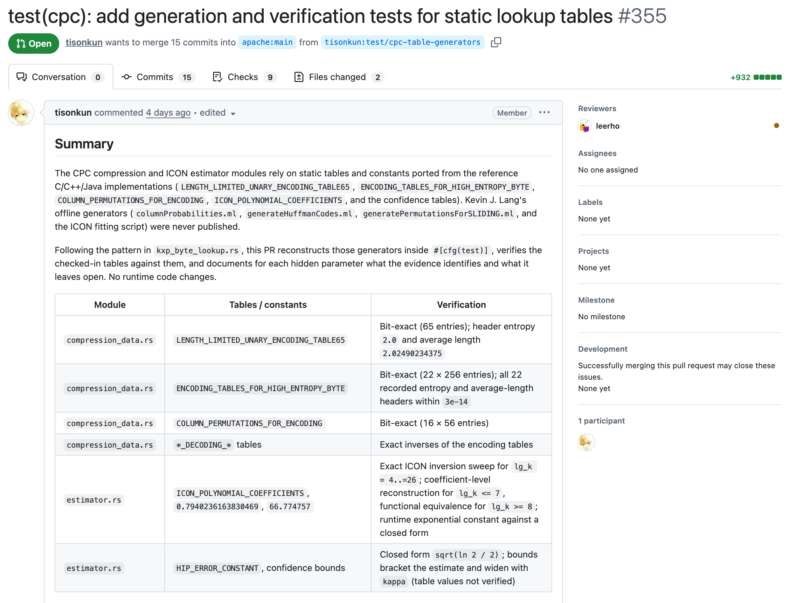

It started with a routine feature in ScopeDB: implementing `approx_count_distinct` for approximate distinct counting.

HyperLogLog (HLL) is the standard textbook choice. Early on, Rust's HLL ecosystem was uneven, so I started with Cloudflare's open-source [cardinality-estimator](https://github.com/cloudflare/cardinality-estimator). That crate leaned heavily on `unsafe` code and manual bit-packing tricks, though, so to keep things auditable and under our control, I forked and maintained an internal copy inside ScopeDB.

While evaluating alternatives, I came across Apache DataSketches, which offered a battle-tested HllSketch alongside CpcSketch, an even more space-efficient design. At the time, Apache DataSketches only shipped Java and C++ implementations, whereas ScopeDB is written in Rust.

As it turned out, the Apache DataSketches community was interested in an official Rust port. Starting late last year, I teamed up with a few other Rust developers well-versed in sketching algorithms to build and ship the initial releases of datasketches-rust, beginning with HllSketch. Soon after, I switched ScopeDB's distinct counting over to our datasketches-rust implementation.


Anyone who has implemented streaming distinct counting knows how HLL works: elements are hashed into $K$ buckets, and each bucket keeps only the maximum leading-zero count seen so far (typically 4 to 6 bits), while every other hit in that bucket goes unrecorded. Once HLL enters dense mode, every bucket maintains a fixed-width register.

In his 2017 paper [Back to the Future: an Even More Nearly Optimal Cardinality Estimation Algorithm](https://arxiv.org/abs/1708.06839), Yahoo! Research scientist Kevin J. Lang proposed going back to basics: instead of keeping only per-bucket maxima, retain the full $K \times 64$ bit matrix of the classic FM85 coupon collector's process. Whenever row $r$ sees a hash with $c$ leading zeros, set bit $(r, c)$ to $1$. Keeping the full two-dimensional hit matrix lets CPC pair a streaming HIP estimator with a mergeable ICON estimator for higher statistical efficiency than HLL. On serialization, it adapts its layout to fill density: low cardinalities use a sparse `PairTable` of `(row, column)` pairs, while medium and high cardinalities combine a sliding 8-bit window, length-limited Huffman coding, and column permutations to pack the sketch near the information-theoretic entropy limit. According to the DataSketches documentation, serialized CPC shrinks storage by 30% to 40% compared with HLL at equal accuracy.

In late January, I ported CpcSketch to datasketches-rust ([PR-75](https://github.com/apache/datasketches-rust/pull/75)) and switched ScopeDB over to it. It has run smoothly in production for more than six months.


While porting CpcSketch from the upstream C++ and Java implementations, however, I noticed several hardcoded magic lookup tables in the source code:

1. 23 static Huffman encoding tables
2. 16 sliding-window column permutations
3. 23 sets of degree-19 polynomial correction coefficients
4. 4 empirical confidence-interval quantile tables

These four sets of static tables live in [`compression_data.rs`](https://github.com/apache/datasketches-rust/blob/0.6.0/datasketches/src/cpc/compression_data.rs) and [`estimator.rs`](https://github.com/apache/datasketches-rust/blob/0.6.0/datasketches/src/cpc/estimator.rs). Here is a short excerpt:

```rust
// datasketches/src/cpc/compression_data.rs
pub static LENGTH_LIMITED_UNARY_ENCODING_TABLE65: [u16; 65] = [
    // entropy:    2.0
    // avg_length: 2.0249023437500000000; max_length = 12; num_symbols = 65
    0x1000, 0x2001, 0x3003, 0x4007, // ...
];
pub static COLUMN_PERMUTATIONS_FOR_ENCODING: [[u8; 56]; 16] = [
    [0, 1, 2, 3, 5, 6, 7, 8, /* ... */ 54, 55, 34, 14, 4],
    // ...
];
pub static ENCODING_TABLES_FOR_HIGH_ENTROPY_BYTE: [[u16; 256]; 22] = [
    // entropy:    4.4619200780464778333
    // avg_length: 4.5415773046232610355; max_length = 12; num_symbols = 256
    [0x9017, 0x5009, 0x7033, 0x3002, /* ... */],
    // ...
];

// datasketches/src/cpc/estimator.rs
static ICON_POLYNOMIAL_COEFFICIENTS: [f64; ICON_TABLE_SIZE] = [
    // log K = 4
    0.9895027971889700513, 0.3319496644645180128, 0.1242818722715769986, // ...
];
static ICON_LOW_SIDE_DATA: [u16; 33] = [
    //1,  2,    3,   kappa
    6037, 5720, 5328, // 4 1000000
    // ...
];
static ICON_HIGH_SIDE_DATA: [u16; 33] = [ /* ... */ ];
static HIP_LOW_SIDE_DATA: [u16; 33] = [ /* ... */ ];
static HIP_HIGH_SIDE_DATA: [u16; 33] = [ /* ... */ ];
```

Whenever I port lookup tables, I prefer to derive the values from first principles in unit tests and check them element by element against the static array. For `kxp_byte_lookup`, for example, I kept the derivation right inside the test suite:

```rust
for byte in 0u8..=255 {
    // expected value
    let expected = KXP_BYTE_TABLE[byte as usize];

    // computed value
    let mut computed = 0.0;
    for col in 0..8 {
        let bit = (byte >> col) & 1;
        if bit == 0 {
            // note the inverted logic
            computed += inv_pow2(col + 1); //note the "+1"
        }
    }

    assert_eq!(expected, computed);
}
```

For `CompressionData` and the ICON estimator tables, though, no generator source existed anywhere in the repositories, so I had no way to derive them on my own back then. Only two build commands remained in an upstream comment:

```sh
~/ocaml-4.03.0/bin/ocamlopt -o generateHuffmanCodes columnProbabilities.ml generateHuffmanCodes.ml
./generateHuffmanCodes > raw-encoding-tables.c
```

I searched every Apache DataSketches repository and came up empty on those `.ml` files. So I opened [ISSUE-720](https://github.com/apache/datasketches-java/issues/720) on datasketches-java to ask where the generator sources lived. Lee Rhodes replied:

> Kevin did most of his math simulations and modeling in OCaml. And his code was on his computer, which no longer exists. And his personal code died with him … even if they have a copy of his old computer it might be trying to find a needle in a haystack.

Kevin passed away in April 2019, and any code left on his personal machine is effectively lost to history.

I was saddened to hear that. Kevin's research in sketching algorithms underpins many of the core sketches in Apache DataSketches:

- [A Framework for Estimating Stream Expression Cardinalities](https://arxiv.org/abs/1510.01455) (Theta Sketch)
- [Optimal Quantile Approximation in Streams](https://arxiv.org/abs/1603.05346) (KLL Sketch, the "L" in KLL)
- [A High-Performance Algorithm for Identifying Frequent Items in Data Streams](https://arxiv.org/abs/1705.07001) (Frequent Items Sketch)
- [Back to the Future: an Even More Nearly Optimal Cardinality Estimation Algorithm](https://arxiv.org/abs/1708.06839) (CPC Sketch and HLL estimators)

Still, with the runtime decoders and detailed header comments sitting right there in the source files, it seemed possible to reverse-engineer the offline generators from the artifacts alone. I asked Lee whether the CPC paper explained how the tables were derived, and he answered:

> You should definitely read the paper. But it won't tell you any details on the Huffman codings. As I recall, in his paper he used a more standard compression scheme. He finished his work on the code after he had finished his paper -- and in the process came up with the modified Huffman coding idea, which is quite a bit more efficient than what he discussed in the paper.

That placed the derivation well beyond what I could work out on my own in an afternoon.

Since CpcSketch worked fine in datasketches-rust as long as the lookup arrays were copied faithfully, I left the mystery aside for the time being.

Then Gemini 4 Carbon came out just as I was preparing the next release of datasketches-rust. Since the checked-in tables and 20-digit header comments already acted as a strict numerical oracle, any candidate generator could be tested immediately in code: either it reproduced every codeword, permutation entry, and floating-point diagnostic within IEEE-754 precision, or it was wrong. That made the problem well suited to an agentic workflow built around executable checks and adversarial review.

Over several iterations, I steered three models against that oracle and against one another:

1. **Initial synthesis (Gemini 4 Carbon)**: Starting from the static arrays and source comments, it wrote executable probes and built the first constructive test harness, reproducing the Huffman codewords and column permutations bit-for-bit and fitting the ICON polynomials to matching accuracy.
2. **Mathematical falsification (Claude Opus 5.5)**: Tasked with breaking those initial claims, it ran controlled ablations that disproved an early "left-edge truncation" explanation, isolated an `f64` cancellation trap, mapped out where the polynomial fits stop being identifiable, and re-ran the million-trial Monte Carlo statistics.
3. **Mutation and analytical audit (GPT 6 Astra)**: Auditing both the tests and the derivations, it used mutation testing to expose two tautological assertions, caught several mathematical overstatements in earlier drafts, and derived a closed-form expression matching the trailing digits of the asymptotic exponential constant.

None of the models got everything right on the first try, and several plausible-looking explanations collapsed as soon as we tested perturbations in code. What survived that filter became [PR-355](https://github.com/apache/datasketches-rust/pull/355), which checks the reconstructed generators and derivations into datasketches-rust as unit tests, following the same approach we took for `kxp_byte_lookup`.



The rest of this post focuses on the mathematics and numerical forensics behind those four sets of tables: how each structure works, which wrong turns looked convincing until an ablation broke them, and where the surviving artifacts cannot tell two models apart. Formal derivations sit in the appendix at the end; if you spot an error, feel free to leave a comment or open a PR on datasketches-rust.

## The Blind Spot of Discrete Codewords, and a 20-Digit Fingerprint

We begin with the 23 Huffman coding tables in [`compression_data.rs`](https://github.com/apache/datasketches-rust/blob/0.6.0/datasketches/src/cpc/compression_data.rs).

Why hardcode 23 static Huffman tables at all? Building trees dynamically per sketch would force the serializer to write tree headers into the compressed stream, wiping out the tens of bytes saved on small sketches. Meanwhile, the probability that column $j$ of the coupon matrix is set depends mainly on the fill ratio $C / K$ (collected coupons $C$ over row count $K$). Finite-$K$ corrections enter only at order $1 / K$, a tiny difference that turns out to be the key clue below. Precomputing optimal tables offline across representative $C / K$ checkpoints lets `determine_pseudo_phase` select the right table solely from `lg_k` and `num_coupons` without storing a table ID.

The first 22 tables encode 8-bit sliding-window bytes ($0$ through $255$). Given the per-column bit probabilities $q_0$ through $q_7$ for the 8 adjacent columns in the window (treated as independent), byte $b$ has theoretical probability equal to the product of eight Bernoulli terms: $q_d$ if bit $d$ is $1$, and $1 - q_d$ if bit $d$ is $0$.

Upstream decoders use a $2^{12} = 4096$-entry lookup table, immediately revealing a hard 12-bit cap on codeword length. Feeding the byte probabilities into Larmore and Hirschberg's 1990 **Package-Merge algorithm** yields the length-limited code lengths; assigning canonical codewords sorted by length and symbol value, then bit-reversing each codeword for CPC's LSB-first bitstream, reproduces all 5,697 codewords across all 23 tables bit-for-bit.

The next question is which occupancy model `columnProbabilities.ml` actually used for column $j$:

1. **Finite-$K$ binomial model**: each item hits column $j$ with single-trial probability $p_j = 1 / (K \cdot 2^j)$, giving $q = 1 - (1 - p_j)^N$ after $N$ insertions.
2. **Infinite-$K$ Poisson limit**: letting $K \to \infty$ with fixed density $N / K = \lambda$, occupancy converges to $q = 1 - \exp(-\lambda / 2^j)$.

Comparing integer codewords alone immediately runs into a blind spot: across the six midrange tables (array indices `16..21`), sweeping $K$ from $2^{16}$ all the way to infinity yields the exact same 256 codewords. Huffman lengths are discrete step functions, so tiny shifts in probability rarely flip tree merge decisions.

What actually acts as a continuous fingerprint to pin down $K$ are the two 20-digit floating-point comments that `generateHuffmanCodes.ml` printed above each table. Here is table 16 (the first midrange byte table):

```text
// entropy:    2.1627885076675394949
// avg_length: 2.2704182849800043087; max_length = 12; num_symbols = 256
```

Shannon entropy $H = -\sum P(b) \log_2 P(b)$ and average code length $\sum P(b) L_b$ vary continuously with the underlying distribution. Holding the $C / K$ checkpoints fixed, we swept $K$ from $2^{28}$ to infinity across all 22 byte tables. Here are the worst-case errors across the six midrange tables:

| Candidate Parameter $K$   | Max Entropy Error $\max \lvert \Delta H \rvert$ | Max Avg Code Length Error |
| :------------------------ | :---------------------------------------------- | :------------------------ |
| $K = 2^{28}$              | $7.38 \times 10^{-10}$                          | $7.25 \times 10^{-10}$    |
| $K = 2^{30}$              | $1.48 \times 10^{-10}$                          | $1.45 \times 10^{-10}$    |
| $K = 2^{31}$              | $4.92 \times 10^{-11}$                          | $4.84 \times 10^{-11}$    |
| **$K = 2^{32}$**          | **$6.22 \times 10^{-15}$**                      | **$6.22 \times 10^{-15}$**|
| $K = 2^{33}$              | $2.46 \times 10^{-11}$                          | $2.42 \times 10^{-11}$    |
| $K = 2^{34}$              | $3.69 \times 10^{-11}$                          | $3.63 \times 10^{-11}$    |
| $K \to \infty$ (Poisson)  | $4.92 \times 10^{-11}$                          | $4.84 \times 10^{-11}$    |

At $K = 2^{32}$, the residual drops by four orders of magnitude, right down to IEEE-754 double-precision rounding noise.

Look at the clean symmetry in that table: $K = 2^{31}$ produces the exact same error as $K \to \infty$, while $K = 2^{33}$ has half the error. That happens because, to first order, the finite-$K$ departure from the Poisson limit scales linearly with $1 / K$ (derived in the first appendix section). When the true parameter is $K_0 = 2^{32}$, both $2^{31}$ and $\infty$ sit one step of $1 / 2^{32}$ away on the $1 / K$ axis, whereas $2^{33}$ sits half a step away. Fittingly, comments in the upstream ICON estimator also put the maximum number of table rows at $2^{32}$ slots.

## Steady-State Tables: The "Left-Edge Truncation" Mirage

Moving to the 16 steady-state tables, which cover phases $\text{phase} = (2m + 1) / 32$ at fill ratios $C / K = B + \text{phase}$, we ran into a convincing false lead.

The column permutation tables (covered next) establish that the steady-state integer baseline is $B = 6$. Yet plugging our newly recovered $K = 2^{32}$ and $B = 6$ into the 16 steady-state tables leaves a **$6.1 \times 10^{-12}$** entropy residual in the 12th decimal place.

At first glance, "left-edge truncation" looks like the obvious explanation: around $C / K \approx 6$, column 1 of the coupon matrix is not quite 100% saturated, and its probability of still being $0$ is roughly $5.3 \times 10^{-12}$, right on the order of the residual. Sure enough, keeping $K = 2^{32}$ fixed and pushing the working point out to $B = 32$ ($C / K = 32 + \text{phase}$) drops the entropy error to $10^{-15}$. Everything seemed to line up to the order of magnitude.

Two controlled ablations quickly ruled that hypothesis out:

1. Holding $B = 6$ fixed while switching from the $K = 2^{32}$ binomial model to the **$K \to \infty$ Poisson limit** drops the error across all 16 steady-state tables to $\sim 10^{-14}$, right down to double-precision rounding noise.
2. Holding $K = 2^{32}$ fixed while stepping $B = 6, 7, 8$ gives maximum entropy errors of $6.1 \times 10^{-12}$, $3.1 \times 10^{-12}$, and $1.5 \times 10^{-12}$, **halving with every $+1$ step in $B$**.

Why does it halve every time? Incrementing $B$ by $1$ shifts the 8-bit sliding window one column to the right, where the binomial correction relative to the Poisson limit decays as $1 / (2K \cdot 2^j) \propto 2^{-B} / K$. Pushing $B$ to $32$ did nothing to left-edge truncation; it merely pushed the window out near column 29, shrinking the in-window finite-$K$ correction $2^{-29} / 2^{32} = 2^{-61}$ below `f64` machine epsilon and **inadvertently faking the $K \to \infty$ Poisson limit with deep columns**.

How much effect can the left edge actually have? Even though the generator solves for $\lambda$ using the **expectation over all 128 columns** before computing window probabilities (so column 1 does enter indirectly through $\lambda$), the shift identity bounds its magnitude cleanly. For the infinite-column Poisson expectation $f(\lambda)$, doubling $\lambda$ shifts the series index by one and adds a single leading term $1 - \exp(-\lambda)$. For the truncated 128-column sum $f_{128}(\lambda) = E[C] / K$ evaluated by the code, cutting off at column 128 subtracts the right-edge tail term as well:

$$
f_{128}(2\lambda) = f_{128}(\lambda) + \left(1 - e^{-\lambda}\right) - \left(1 - e^{-\lambda / 2^{128}}\right)
$$

In other words, incrementing $B$ by $1$ doubles $\lambda$ and shifts the window one column right, keeping in-window distributions nearly shift-invariant up to the left- and right-edge truncation terms. At $C / K = 6 + 1/32$ ($\lambda \approx 51.93$), the left-edge term $\exp(-\lambda)$ is roughly $2.8 \times 10^{-23}$ (a $\sim 2 \times 10^{-23}$ relative effect on $\lambda$), and the right-edge term $1 - \exp(-\lambda / 2^{128})$ is roughly $1.53 \times 10^{-37}$. Both sit more than ten and twenty orders of magnitude below the $10^{-12}$ residual. The discrepancy came from finite $K$, not the left edge.

This also draws a sharp **identifiability boundary**. On the 16 steady-state tables alone, under the test's $3 \times 10^{-14}$ tolerance, both the Poisson limit for $6 \le B \le 84$ and the $K = 2^{32}$ binomial model for $14 \le B \le 84$ match every entropy and average-length header within tolerance. They are not bit-identical (still differing by $\sim 10^{-14}$), only indistinguishable within double-precision arithmetic and that tolerance. Right at $B = 84$, the 128-column right-edge term has already grown exponentially to $\sim 4.61 \times 10^{-14}$; by $B = 85$, table 7's average-length error hits $3.11 \times 10^{-14}$ and breaks tolerance; further right, right-edge truncation takes over completely, reaching $7.4 \times 10^{-10}$ at $B = 100$. We chose the "$B = 6$ Poisson limit" model because it shares the exact working point of the column permutations without inventing an arbitrary $B = 32$, though the static tables by themselves cannot rule out the equivalent finite-$K$ shifted interval.

## Column Permutations: A Rounding Trap at Phase 19/32

In the steady-state regime, columns left of the sliding window are nearly all $1$, while columns to the right are nearly all $0$. The remaining 56 out-of-window columns therefore store only **surprising bits**, namely zeros left of the window or ones right of the window, encoded via column index deltas. Putting higher-probability surprising columns first keeps unary deltas short, which is what the 16 56-byte tables from `generatePermutationsForSLIDING.ml` accomplish.

First, their indexing scheme:

- Let the window offset be $\omega = \lfloor C / K - 2.375 \rfloor$. Physical 0-based column `col` maps to canonical index `canon = (col + 56 - offset) % 64`, putting right-side columns first and the $\omega$ left-side columns at the tail.
- The 56 canonical slots are ranked in descending order of surprising-bit probability.
- Each static array stores `encode_perm[canon] = rank`, rather than listing columns in sorted order.

That layout alone pins down $B$: in the first six tables (phase indices `0..5`), three trailing slots correspond to columns left of the window and get interleaved upward; in the last ten tables, that count jumps to four. Since $\omega$ steps from $B - 3$ to $B - 2$ at phase `3/8`, jumping from 3 to 4 settles $B = 6$. Testing candidates confirms it directly: $B = 5, 6, 7$ match $6, 16, 10$ tables out of 16, respectively. Unlike the byte tables, sweeping $K$ from $2^8$ to $\infty$ leaves all 16 permutation tables byte-for-byte identical: **column permutations are completely insensitive to $K$**.

Once $B = 6$ is fixed, a subtle numerical trap waits in $p_0$, the probability that a column left of the window remains $0$. If you lazily compute `1.0 - q` from the already-computed 1-bit probability $q$, both $B = 6$ and $B = 7$ match 15 out of 16 tables, **missing just 4 entries in the single table for phase 19/32**. At that phase ($\omega = 4$), look at the four trailing slots:

| Canonical Index `canon` | Physical Column (1-based) | Surprising Probability      | Rank |
| :---------------------- | :------------------------ | :-------------------------- | :--- |
| 49                      | 62                        | $1.6630 \times 10^{-17}$    | 53   |
| 50                      | 63                        | $8.3150 \times 10^{-18}$    | 54   |
| 51                      | 64                        | $4.1575 \times 10^{-18}$    | 55   |
| 52                      | 1                         | $2.2211 \times 10^{-17}$    | 52   |

Physical column 1 has surprising probability $p_0 = \exp(-\lambda / 2) \approx 2.22 \times 10^{-17}$, strictly larger than column 62's $1.66 \times 10^{-17}$. Sorted by descending probability, the trailing canonical sequence must be 48, 52, 49, 50, 51, putting `[53, 54, 55, 52]` at slice `encode_perm[49..=52]`. Computing `1.0 - q` instead pushes slot 52 to last place, yielding `[52, 53, 54, 55]`.

The root cause is floating-point cancellation. Although $2.22 \times 10^{-17}$ is easily representable in IEEE-754 `f64` (nowhere near underflow), $q = 1 - p_0$ lands right below $1.0$, where adjacent doubles are spaced by $2^{-53}$. Under round-to-nearest-even, whenever $p_0 \le 2^{-54} \approx 5.55 \times 10^{-17}$, $q$ rounds up to $1.0$, turning `1.0 - q` into $0.0$ and wiping out $p_0$ completely before subtraction even happens.

Evaluating the exponential directly (such as `(-lambda / 2^j).exp()` in Rust) avoids catastrophic cancellation and reproduces all 16 permutation tables bit-for-bit at $B = 6$. This single comparison simultaneously rules out $B = 7$ and `1.0 - q`, though strictly speaking, it only proves Kevin's generator did not use `1.0 - q`, not the exact syntax he wrote.

## Degree-19 Polynomials and the Exponential Constant

Next comes the **ICON cardinality estimator** in [`estimator.rs`](https://github.com/apache/datasketches-rust/blob/0.6.0/datasketches/src/cpc/estimator.rs). Rather than running Newton's method across all 128 columns at query time, Kevin designed a two-piece approximation:

- For $C \le 5.7K$ (tightened to $5.6K$ for `lg_k` $\ge 14$), evaluate a **degree-19 polynomial** preconditioned with a cubic leading factor
- Beyond that splice point, switch to an asymptotic exponential formula

$$
\hat{N}_{\text{poly}}(K, C) = C \left(1 + \frac{(C/K)^3}{66.774757}\right) \sum_{m=0}^{19} a_m(K) \left(\frac{C}{2K}\right)^m
$$

$$
\hat{N}_{\text{exp}}(K, C) = 0.7940236163830469 \cdot K \cdot 2^{C/K}
$$

Factoring out $1 + (C / K)^3 / 66.774757$ keeps the polynomial's target ratio within $[0.89, 1.48]$, instead of letting $N / C$ expand more than $8\times$ over $[0, 6]$. Scaling the variable as $x = C / (2K)$ maps $[0, 6K]$ onto $[0, 3]$, keeping $x^{19}$ at $3^{19} \approx 1.16 \times 10^9$ rather than $6^{19} \approx 6.09 \times 10^{14}$.

### Fitting Interval and Identifiability

If runtime switches branches at $5.6K$ or $5.7K$, what domain were the 23 polynomials originally fitted over? Evaluating the checked-in polynomials past the runtime cutoff reveals a clear pattern:

- Every row holds relative error within $5 \times 10^{-7}$ all the way out to $C = 6K$, then diverges rapidly just past $6K$; by $6.25K$, errors jump to between $4 \times 10^{-6}$ and $1.3 \times 10^{-4}$ across the board.
- For `lg_k` $= 4$ ($K = 16$), the cliff is razor-sharp: across $C = 2\text{..}96$, maximum relative error is $8.7 \times 10^{-8}$ (at $C = 95$), dips to $1.3 \times 10^{-8}$ at $C = 96$, and spikes two orders of magnitude to $2.2 \times 10^{-6}$ at $C = 97$.
- At larger $K$, however, a single integer step barely moves $C / K$, smoothing out any sharp break: at `lg_k` $= 8$, relative error at $C = 6K + 1$ is still $-6.6 \times 10^{-8}$, even slightly smaller than at $C = 6K$.

Our confidence that fitting stopped right at $6K$ therefore relies on the coefficient regression below rather than error cliffs alone. Extending the fit slightly past the $5.6K / 5.7K$ threshold makes intuitive sense as a buffer against Runge boundary oscillations, though no upstream note confirms that intent.

Attempting to reconstruct the coefficients exposes a sharp **identifiability boundary** between small and large sketches:

- For `lg_k` $\le 7$ ($6K \le 768$ integer points), unweighted least squares on **every integer point from $C = 1$ to $6K$** recovers all 20 coefficients within 0.07% to 1.4% of upstream values. Dropping $C = 1$ or shifting either endpoint by $1$ degrades coefficient agreement by $4\times$ to $59\times$. While that strongly supports an all-integer $[1, 6K]$ grid, it still leaves details unpinned: relative-error weighting actually fits slightly closer at `lg_k` $= 4$, and the original solver details are lost.
- For `lg_k` $\ge 8$, both all-integer grids and boundary-weighted grids yield coefficients 14% to 65% off from upstream, even while predicted values track the reference curve within $3 \times 10^{-7}$ in-range and within $\max(2.5 \times 10^{-6},\, 1 / (80K))$ past the splice point. Recovering high-degree monomial coefficients from samples is severely ill-conditioned: the unscaled degree-19 Vandermonde matrix on $[1, 6K]$ has an $L_2$ condition number around $10^{17}$ ($1.19 \times 10^{17}$ at `lg_k` $= 4$), still hovering around $10^{14}$ after column normalization. Two coefficient vectors far apart in Euclidean space can produce virtually identical curves.

### Three Constants Behind the Exponential Branch

The exponential constant and upstream test bounds used to look like pure empirical tuning. In reality, all three fall straight out of the Poisson model (derived in the appendix):

1. **Leading constant**: Taking the Mellin transform of the infinite-column Poisson expectation and computing the residue at the double pole $s = 0$ yields $E[C] / K = \log_2 \lambda + \gamma / \ln 2 - 1/2 + \mathcal{P}(\log_2 \lambda) + R(\lambda)$, where $\mathcal{P}$ is 1-periodic and $R(\lambda) = \sum \exp(-2^r \lambda)$ drops below $2 \times 10^{-17}$ on the exponential branch ($\lambda \ge 38.5$). Neglecting $\mathcal{P}$ and $R$ gives $\lambda \approx D \cdot 2^{C/K}$ with closed form $D = \sqrt{2}\,e^{-\gamma} = 0.7940236163832829\dots$, differing from the hardcoded runtime constant only in the 13th decimal place by $\sim 2.36 \times 10^{-13}$.
2. **Part-per-million periodic ripple**: The oscillatory series $\mathcal{P}$ arises from simple poles on the imaginary axis; its fundamental harmonic adds a periodic ripple of relative amplitude $a = 2\lvert\Gamma(2\pi i / \ln 2)\rvert \approx 1.0904 \times 10^{-6}$, setting the exact accuracy floor observed at large $K$.
3. **Why `1 / (80 * K)` in upstream tests**: Java's `IconEstimatorTest` uses an error bound of `max(2e-6, 1.0 / (80 * k))`. Finite-$K$ effects make the Poisson formula slightly overestimate cardinality, reaching peak relative bias $1 / (2K\lambda) \approx 1 / (82.6K)$ at the $C = 5.7K$ ($\lambda \approx 41.3$) splice point. Rounding $82.6$ down to $80$ covers that peak with roughly a 3% margin, though whether Kevin picked 80 this way is undocumented.

### Pinning Down the Trailing Digits

That $2.36 \times 10^{-13}$ gap between $D$ and the runtime constant has a remarkably crisp mathematical explanation down to the last bit. Suppose $A$ was chosen so that $A \cdot K \cdot 2^{C/K}$ has **zero mean relative error over one period** relative to the exact Poisson inverse. By the appendix derivation on period-mean relative error, $A$ must satisfy:

$$
\begin{aligned}
A &= \frac{D}{\left\langle e^{(\ln 2)\mathcal{P}(t)} \right\rangle} \approx D \left(1 - \frac{a^2}{4}\right) \\
  &= D \left(1 - \left\lvert\Gamma\!\left(\frac{2\pi i}{\ln 2}\right)\right\rvert^2\right) = 0.79402361638304686\dots
\end{aligned}
$$

Replacing $\langle e^{(\ln 2)\mathcal{P}(t)} \rangle$ with the second-order expansion of the modified Bessel function $I_0(a)$ omits only $\sim 5 \times 10^{-26}$, far below double precision. Rounded to `f64`, **this closed form matches `0.7940236163830469` bit-for-bit**. Our unit test queries the production constant directly at runtime and verifies an exact match (and agrees within 2 ULPs against numerical harmonic integration over a full cycle). Still, the epistemological caveat holds: showing that an optimality criterion reproduces a constant bit-for-bit does not prove Kevin wrote that exact criterion.

## A Million Monte Carlo Trials and the Discrete Staircase Effect

The remaining pieces are the four confidence-bound tables: `ICON_{LOW,HIGH}_SIDE_DATA` and `HIP_{LOW,HIGH}_SIDE_DATA`. Upstream comments note that they record empirical quantiles from $\sim 10^6$ Monte Carlo trials per row at true cardinality $N = 1000K$: each cell stores $(10^4 \sqrt{K} \cdot \varepsilon) / \kappa$ rounded to an integer, where $\varepsilon$ is the one-sided relative-error quantile corresponding to normal tail probability $\Phi(-\kappa)$.

Stochastic tables cannot be reconstructed bit-for-bit like Huffman codes; they have to be checked statistically against independent simulations. Two practical hurdles arise immediately: how to run $10^6$ trials across `lg_k` `= 4..=14` on a single machine, and why today's numbers match Kevin's original integers as closely as they do.

Simulating individual insertions naively at `lg_k` $= 14$ ($K = 16384$) takes $1.6 \times 10^7$ steps per trial ($1.6 \times 10^{13}$ iterations across $10^6$ trials), which is impractical on a single machine. Our fast simulator builds on the exponential-skip coupon process Kevin sketched in Appendix B of his paper: maintain just 64 empty-cell counters $m_j$, the running HIP accumulator, and processed element count. Note one essential catch: **HIP values cannot be reconstructed from final column counts alone**, because HIP is strictly path-dependent on discovery order. As a minimal counterexample at $K = 16$, hitting column 1 and then column 2 yields `2.0323`, whereas hitting column 2 and then column 1 yields `2.0159`, even though the final column counts are identical. At each step, total new-cell probability is $p_{\text{hit}} = \sum m_j / (K \cdot 2^j)$, so waiting steps between hits follow an exact geometric distribution sampled via a single logarithm; on each hit, add $1 / p_{\text{hit}}$ to HIP and sample column $j$ proportionally to $m_j \cdot 2^{-j}$.

One subtle implementation boundary also belongs on the record: the fast simulator assigns explicit weight $2^{-64}$ to physical column 64 (index 63) with initial `kxp` $= K$ absorbing the remaining tail mass, whereas `sketch.rs` folds all hashes with $\ge 63$ leading zeros into column 64 (actual hit probability $2^{-63}$) while still deducting $2^{-64}$ from `kxp` and calling `refresh_kxp` every 8 shifts to limit floating-point drift. Ideal and sketch processes therefore match strictly only as long as column 64 goes unhit and `refresh_kxp` drift stays negligible. Across over $4 \times 10^{13}$ simulated insertions in our runs, expected column-64 hits total roughly $4.5 \times 10^{-6}$, making it irrelevant in practice. Skipping empty draws reduces per-trial cost from $O(N)$ to $O(C)$ (roughly $10K$ coupons at $N = 1000K$), cutting runtime by two orders of magnitude so all 11 rows ($10^6$ trials each in `simA`) finished in ~11 minutes across 14 threads.

We also had to avoid a statistical pitfall. Because all six quantiles in a row ($-3\sigma$ to $+3\sigma$) come from the same $10^6$ trials, they are correlated; simply summing squared per-cell z-scores against a $\chi^2$ distribution is invalid. We saved full raw trial vectors $C$ and $\text{HIP} / N$ to disk across three runs:

1. `simA`: $10^6$ trials per row across all 11 rows (`lg_k` `= 4..=14`)
2. Real CpcSketch control: $10^6$ trials per row with MurmurHash3 across `lg_k` `= 4..=7`, with independent stream seeds per `lg_k`
3. `simB`: a second independent seed of the fast simulator across `lg_k` `= 4..=12` (9 rows)

We estimated each row's $6 \times 6$ quantile covariance matrix in two independent ways, using **2,000 nonparametric Bootstrap resamples** and **Siddiqui's order-statistic asymptotic variance formula**, and formed joint Mahalanobis $T^2$ statistics across independent rows.

Both sanity-check controls held cleanly and agreed closely between both covariance estimators:

- **Same-simulator null control**: Comparing `simA` vs. `simB` across all 54 shared degrees of freedom (`lg_k` `= 4..=12`) yields $T^2 = 62.58$ ($p = 0.198$) under Bootstrap covariance and $T^2 = 63.77$ ($p = 0.171$) analytically, showing textbook agreement between two independent $10^6$-trial batches.
- **Real CpcSketch control**: Comparing real sketches against `simA` over 24 DoF (`lg_k` `= 4..=7`) yields $T^2 = 36.72$ ($p = 0.047$) Bootstrap and $T^2 = 36.20$ ($p = 0.052$) analytic; comparing against the average of `simA` and `simB` gives $T^2 = 34.65$ ($p = 0.074$) and $T^2 = 33.96$ ($p = 0.085$). Zero of the 24 cells exceeded $3\sigma$, and only one exceeded $2\sigma$, showing no sign of systematic bias.

Comparing against Kevin's checked-in tables revealed a clear divide between ICON and HIP:

- **ICON tables**: Across all 66 cells, `simA` reproduces **59 of Kevin's integers verbatim**, with every underlying float sitting inside the $\pm 0.5$ rounding interval. In `simB`, 51 of 54 shared cells match verbatim, with 49 exact matches overlapping across Upstream, `simA`, and `simB`.
- **HIP tables**: Under row independence, uniform $1/12$ rounding variance, and upstream trial-count covariance, Upstream vs. `simA` over 66 DoF yields $T^2 = 103.97$ ($p = 1.99 \times 10^{-3}$; analytic $T^2 = 102.27$, $p = 2.81 \times 10^{-3}$); Upstream vs. `simB` over 54 DoF yields $T^2 = 73.46$ ($p = 0.040$; analytic $T^2 = 73.04$, $p = 0.043$); and Upstream vs. the average of `simA` and `simB` gives $T^2 = 87.29$ ($p = 2.77 \times 10^{-3}$; analytic $T^2 = 86.36$, $p = 3.39 \times 10^{-3}$). Most of the signal concentrates in `lg_k` $= 7, 9, 11$: in `simA` their single-row $p$-values are $5.4 \times 10^{-3}$, $0.014$, and $9.5 \times 10^{-4}$, yielding Holm-adjusted $p$-values across 11 rows of $0.010$ (`lg_k` $= 11$), $0.054$ (`lg_k` $= 7$), and $0.13$ (`lg_k` $= 9$), whereas in independent `simB` their single-row $p$-values are $0.092$, $0.066$, and $0.167$. So while a mild aggregate discrepancy exists, row-level evidence is too uneven to pin down those three rows conclusively. In absolute terms, the largest difference across all 66 cells is just $83.74$ table units (at `lg_k` $= 9$, $-3\sigma$), changing error factor $\varepsilon$ by at most **1.49%** and one-sided confidence width by roughly **1.61%**. That shift is minor in practice, though we did not re-measure empirical coverage rates directly.

Why do nearly 90% of stochastic ICON quantile cells match Kevin's original integers down to the last digit? Because **ICON depends solely on the integer coupon count $C$**, confining estimates to discrete "stair steps". In a million-trial batch, as long as a target quantile does not straddle an integer-$C$ transition and trigger sample interpolation — and inspecting all 66 target quantiles confirms none did — the sample quantile lands cleanly on a single integer $C$ step. Each $+1$ step in $C$ raises the scaled table entry by:

$$
\Delta_{\text{atom}}(C) = \frac{10^4 \sqrt{K}}{\kappa} \frac{\hat{N}(C)}{N} \left(2^{1/K} - 1\right) \approx \frac{10^4 \ln 2}{\sqrt{K}\,\kappa}
$$

At `lg_k` $= 4$, $\kappa = 1$, adjacent steps sit roughly 1,733 units apart. Step widths vary slightly with $\hat{N}(C) / N$, yet whenever two independent Monte Carlo runs fall on the same integer $C$, their unrounded floats agree **to the last bit** and round to the same integer. Inverting the 7 mismatched cells shows that every upstream entry also sits within $\pm 0.5$ of an exact integer-$C$ step, just 1 to 3 counts away (5 cells differ by $1\,C$, and one cell each by $2\,C$ and $3\,C$). At `lg_k` $= 7$, $+1\sigma$, for example, our run hits $C = 1329$ (`6806.33`), while Kevin's `7458` rounds neighboring $C = 1330$ (`7457.61`). Streaming HIP, by contrast, spans a vastly denser set of values even at finite $N$, so independent runs never lock onto the same integers across years the way ICON does.

To be clear, the million-trial Monte Carlo simulator and raw trial outputs were kept locally as an independent verification record rather than checked into the PR.

## What the Evidence Can and Cannot Prove: Six Open Questions

The reconstructed generators, closed-form constants, and hardened tests have been merged upstream in [PR-355](https://github.com/apache/datasketches-rust/pull/355).

Writing those unit tests underscored an important engineering lesson: **never write tautological tests**. An earlier draft verified the asymptotic constant against a second hardcoded copy inside the test file, and checked confidence bounds only by testing whether they bracketed the point estimate. Simple mutation testing exposed both gaps immediately: changing the production constant to a coarse `0.794024` or zeroing out all 132 confidence-table entries still passed every test. We hardened the merged tests in two ways: the constant test calls production code directly to compare the runtime constant against the closed form, and the confidence-table test asserts strict monotonicity of interval width with `kappa` while stating its verification limits explicitly in comments. Today, all 23 Huffman tables and 16 permutation tables have bit-exact constructive tests, whereas the Monte Carlo confidence tables clearly document that unit tests do not verify empirical cell values or true coverage.

When reverse-engineering legacy numerical code, the biggest trap is thinking, "all tests pass, so we recovered what the author wrote." **Proving a model reproduces the artifacts is not proving the author coded that model.** Throughout code comments and this report, we drew a bright line between parameters uniquely pinned by data and equivalence classes that observations cannot tell apart, leaving six open questions for the community:

1. **Steady-state byte table model**: Did Kevin's script evaluate the Poisson limit directly, or a $K = 2^{32}$ binomial model shifted out to $14 \le B \le 84$? Under `f64` arithmetic and a $3 \times 10^{-14}$ tolerance, both pass indistinguishably.
2. **Package-Merge tie-breaking**: One 65-symbol merge hits an exact weight tie $P(62) = P(63) + P(64) = 2^{-63}$, yet leaf-first and package-first tie-breaking produce identical code lengths across all 23 tables.
3. **Origin of the cubic denominator**: Why the leading cubic factor uses `66.774757` remains unexplained analytically or in upstream notes.
4. **Polynomial fitting grid and weights**: An all-integer $[1, 6K]$ grid has strong ablation support for `lg_k` $\le 7$, though weighting details remain unpinned; for `lg_k` $\ge 8$, sampling grids are completely unidentifiable beneath $\sim 10^{17}$ condition numbers.
5. **Selection criterion for `0.7940236163830469`**: Zero period-mean relative error reproduces the constant down to the last bit, but whether Kevin explicitly solved that optimization problem cannot be confirmed.
6. **Mild HIP confidence-table scatter**: Under row independence and continuous order-statistic approximations, our $10^6$-trial runs show a mild overall divergence concentrated in `lg_k` $= 7, 9, 11$ (varying per-row strength; max cell diff $83.7$ units / 1.49% relative error-factor shift). Existing artifacts cannot separate historical sampling noise, batch details, and tiny implementation quirks; bit-exact reproduction would require the original PRNG and seed.

When I first spotted those two orphaned `ocamlopt` lines while porting CpcSketch back in January, they looked like a dead end. After chasing 12th-decimal floating-point residuals, falsifying intuitive guesses with ablations, tracing poles on the complex plane, running million-trial Monte Carlo sweeps with full covariance matrices, and pinning down test boundaries with mutation testing, almost every piece of mathematics Kevin J. Lang built into production code without publishing in his paper has been reconstructed — and where exact reconstruction stops, we now know the exact boundary of what the artifacts can tell us.

## Appendix: Analytic Derivations

### First-Order Expansion of Finite-K Entropy Error

In column $j$, letting $x = 1 / (K \cdot 2^j) \ll 1$, the log-survival probability in the finite-$K$ binomial model expands via Taylor series as:

$$
\ln(1 - q_{\text{bin}}) = N \ln(1 - x) = -N\left(x + \frac{x^2}{2} + O(x^3)\right) = -\frac{N}{K \cdot 2^j}\left(1 + \frac{1}{2K \cdot 2^j} + O(K^{-2})\right)
$$

Comparing this with the Poisson limit $\ln(1 - q_{\text{poi}}) = -\lambda / 2^j$, finite $K$ multiplies each column exponent by a perturbation factor $1 + 1 / (2K \cdot 2^j)$. Since that factor decays as $2^{-j}$ across columns, tuning a single global scalar $\lambda$ cannot cancel deviations across all 8 window columns simultaneously, leaving residual perturbations $\delta q_j = O(2^{-j} / K)$ that shift Shannon entropy linearly in $1 / K$: $\Delta H = \alpha / K + O(K^{-2})$.

### Mellin Transform Derivation of the Leading Term and Periodic Ripple

Taking the Mellin transform $f^*(s) = \int_0^\infty f(\lambda)\,\lambda^{s-1}\,d\lambda$ of the infinite-column expectation sum $f(\lambda) = \sum_{j \ge 1} (1 - e^{-\lambda / 2^j})$ in the fundamental strip $-1 < \operatorname{Re}(s) < 0$ using $\int_0^\infty (1 - e^{-x}) x^{s-1}\,dx = -\Gamma(s)$ (sanity-checking the sign at $s = -1/2$: a positive integrand matches $-\Gamma(-1/2) = 2\sqrt{\pi} > 0$) yields the transform and oscillatory Fourier series:

$$
f^*(s) = -\Gamma(s) \sum_{j=1}^{\infty} 2^{js} = -\Gamma(s) \frac{2^s}{1 - 2^s}
$$

$$
\mathcal{P}(t) = -\frac{1}{\ln 2}\sum_{k \neq 0} \Gamma\!\left(\frac{2\pi i k}{\ln 2}\right) e^{-2\pi i k t}
$$

$$
a = 2\left\lvert\Gamma\!\left(\frac{2\pi i}{\ln 2}\right)\right\rvert = 2\sqrt{\frac{\pi}{y \sinh(\pi y)}} \approx 1.0904 \times 10^{-6}, \quad y = \frac{2\pi}{\ln 2}
$$

Shifting the inversion contour rightward past all poles along $\operatorname{Re}(s) = 0$ produces the large-$\lambda$ asymptotic expansion $f(\lambda) = \log_2 \lambda + \gamma / \ln 2 - 1/2 + \mathcal{P}(\log_2 \lambda) + R(\lambda)$, where $R(\lambda) = \sum_{r \ge 0} \exp(-2^r \lambda) < 2 \times 10^{-17}$ on the exponential branch ($\lambda \ge 38.5$):

- **Double pole at $s = 0$**: Multiplying $\Gamma(s) = 1/s - \gamma + O(s)$ by $2^s / (1 - 2^s) = -1 / (s \ln 2) - 1/2 + O(s)$ yields the logarithmic leading term $\log_2 \lambda + \gamma / \ln 2 - 1/2$. Equating this to $C / K$ gives $\lambda \approx \sqrt{2}\,e^{-\gamma} \cdot 2^{C/K}$.
- **Simple poles at $s_k = 2\pi i k / \ln 2$**: Nonzero integers $k \neq 0$ contribute the 1-periodic ripple $\mathcal{P}(t)$, dominated by its $k = \pm 1$ fundamental harmonic. Converting to relative amplitude in $\lambda$ (multiplying by $\ln 2$) yields $a \approx 1.0904 \times 10^{-6}$.

### Period-Mean Relative Error and the Exponential Constant

Dropping $R(\lambda)$ and writing $t = \log_2 \lambda$, inverting $C / K \approx \log_2 \lambda + \gamma / \ln 2 - 1/2 + \mathcal{P}(t)$ gives $\lambda \approx D \cdot 2^{C/K} e^{-(\ln 2)\mathcal{P}(t)}$, so $A \cdot 2^{C/K}$ has relative error $(A / D) e^{(\ln 2)\mathcal{P}(t)} - 1$. Setting its period mean to zero requires the harmonic mean $A = D / \langle e^{(\ln 2)\mathcal{P}(t)} \rangle$.

Representing the fundamental harmonic of $(\ln 2)\mathcal{P}(t)$ as $a \cos(2\pi t + \varphi)$ (mean square $a^2 / 2$) integrates to the modified Bessel function $\langle e^{(\ln 2)\mathcal{P}} \rangle \approx I_0(a) = 1 + a^2/4 + a^4/64 + \dots$, yielding $A \approx D(1 - a^2 / 4)$. Because $a^2 / 4 \approx 3 \times 10^{-13}$, $D / I_0(a)$ and $D(1 - a^2 / 4)$ differ by only $\sim 5 \times 10^{-26}$ (and higher harmonics are negligible). Moreover, averaging over $C / K$ gives the exact same result as averaging over $t$: in $d(C / K) = (1 + \mathcal{P}'(t))\,dt$, the derivative integral $\int_0^1 e^{(\ln 2)\mathcal{P}(t)} \mathcal{P}'(t)\,dt = 0$ vanishes identically over $[0, 1]$.

### Finite-K Overestimation at the Splice Point

At fixed $C / K$, finite $K$ requires a slightly lower true density $\lambda$ than the infinite-$K$ limit, so the Poisson-derived exponential branch slightly overestimates cardinality near the splice point $C = 5.7K$. Plugging $\lambda_{\text{splice}} \approx 0.794 \times 2^{5.7} \approx 41.3$ into the first-order finite-$K$ correction gives the peak relative bias:

$$
\frac{\Delta \hat{N}}{N} \approx \frac{1}{2 \lambda_{\text{splice}} K} \approx \frac{1}{82.6 K}
$$

### Asymptotic Relative Standard Errors of ICON and HIP

For $\lambda \gg 1$, matrix cells are independent in the Poisson limit, so total coupon variance sums across columns as $\operatorname{Var}(C) \approx K \sum \exp(-\lambda / 2^j)\left(1 - \exp(-\lambda / 2^j)\right)$. Approximating the sum by a continuous integral over one dyadic decade yields a standard **Frullani integral**:

$$
\frac{\operatorname{Var}(C)}{K} \approx \frac{1}{\ln 2}\int_0^\infty \frac{e^{-u} - e^{-2u}}{u}\,du = 1 \implies \operatorname{sd}(C) \approx \sqrt{K}
$$

$$
\operatorname{Var}(\hat{N}_{\text{HIP}}) \approx \int_0^N \left(\frac{1}{p} - 1\right) dn \approx \frac{\ln 2}{2} \frac{N^2}{K} \implies \operatorname{RSE}(\hat{N}_{\text{HIP}}) \approx \sqrt{\frac{\ln 2}{2}} \frac{1}{\sqrt{K}}
$$

- **ICON estimator**: Propagating $\operatorname{sd}(C)$ through the exponential branch $\hat{N}_{\text{ICON}} \propto 2^{C/K}$ gives $\operatorname{RSE}(\hat{N}_{\text{ICON}}) \approx (\ln 2 / K)\operatorname{sd}(C) = \ln 2 / \sqrt{K}$, matching `ICON_ERROR_CONSTANT` $= \ln 2$ in source code.
- **HIP estimator**: At arrival density $\lambda = n / K$, a new item flips an empty cell with probability $p \approx 1 / (\lambda \ln 2)$. Integrating conditional step variance $(1 / p - 1)$ from $0$ to $N$ yields $\operatorname{RSE}(\hat{N}_{\text{HIP}}) \approx \sqrt{(\ln 2) / 2} / \sqrt{K}$, whose constant evaluates to `0.5887050112577373` in source code.
