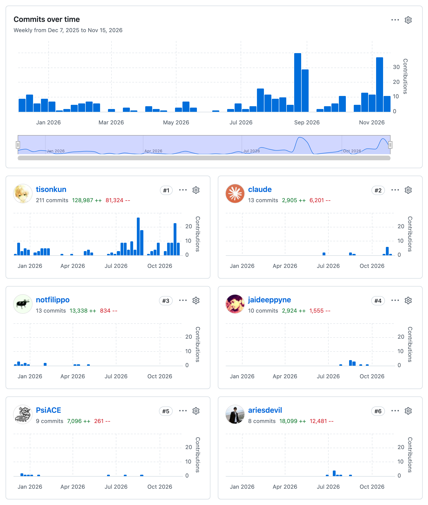
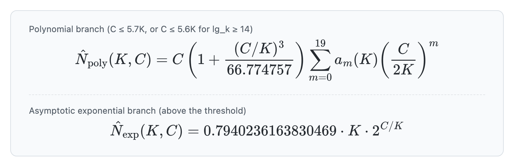
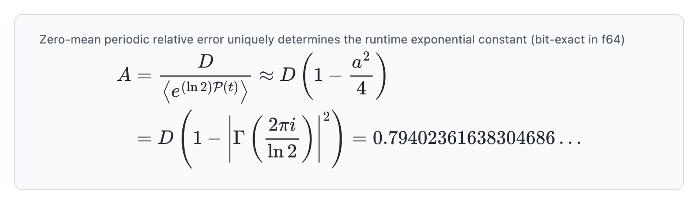
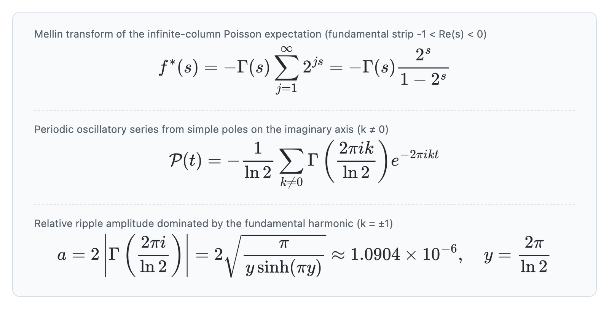
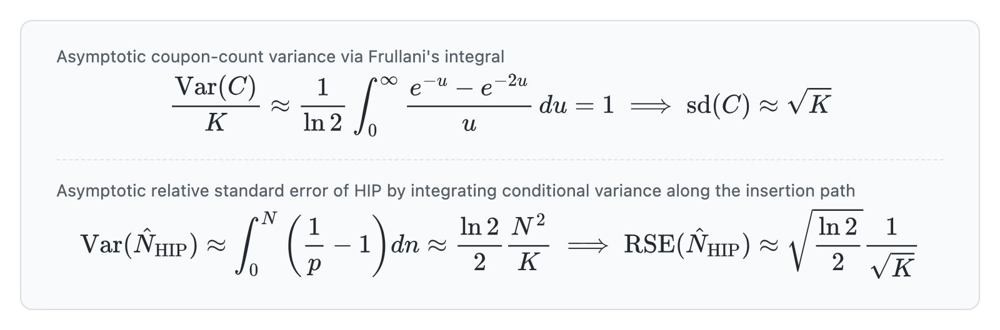

Here is how it started.

While building ScopeDB, I needed approximate distinct counting for our `approx_count_distinct` function.

The standard textbook choice for this is HyperLogLog (HLL). Early on, Rust's HLL ecosystem was uneven, so I chose Cloudflare's open-source [cardinality-estimator](https://github.com/cloudflare/cardinality-estimator). However, that crate leaned heavily on `unsafe` code and manual bit-packing tricks. To keep things auditable and under our control, I forked and maintained an internal copy inside ScopeDB.

During that evaluation, I learned about Apache DataSketches, which offers a battle-tested `HllSketch` alongside `CpcSketch`, an even more space-efficient design. At the time, Apache DataSketches only shipped Java and C++ implementations, whereas ScopeDB is written in Rust.

As luck would have it, the Apache DataSketches community was interested in maintaining an official Rust port. Starting late last year, several Rust developers familiar with sketch algorithms and I built and shipped the initial releases of `datasketches-rust`, beginning with `HllSketch`. Soon after, I switched ScopeDB's distinct counting over to our `datasketches-rust` `HllSketch` implementation.



Anyone who has implemented streaming distinct counting knows how HLL works: elements are hashed into `K` buckets, and each bucket stores only the maximum leading-zero count observed so far, typically taking 4 to 6 bits per register. Consequently, any hit smaller than a bucket's current maximum is discarded on arrival, and once HLL enters dense mode, every bucket maintains a fixed-width register.

In his 2017 paper [Back to the Future: an Even More Nearly Optimal Cardinality Estimation Algorithm](https://arxiv.org/pdf/1708.06839), Yahoo! Research scientist Kevin J. Lang proposed going back to basics: instead of keeping only the per-bucket maximum, keep the full `K × 64` bit matrix of the classic FM85 coupon collector's process. Whenever row `r` sees a hash with `c` leading zeros, bit `(r, c)` is set to `1`. Retaining the full two-dimensional hit matrix enables CPC to pair a streaming HIP estimator with a mergeable ICON estimator for higher statistical efficiency than HLL. When serialized, it adapts its layout to fill density: low cardinalities use a sparse `PairTable` of `(row, column)` coordinates, while medium and high cardinalities combine a sliding 8-bit window, length-limited Huffman coding, and column permutations to pack the sketch down near the information-theoretic entropy limit. According to the DataSketches documentation, serialized CPC shrinks storage by 30% to 40% compared with HLL at equal accuracy.

Late this January, I ported `CpcSketch` to `datasketches-rust` in [PR-75](https://github.com/apache/datasketches-rust/pull/75) and switched ScopeDB to CPC. It has run smoothly in production for over half a year.


When porting `CpcSketch` from the upstream C++ and Java codebases, however, I ran into rows upon rows of hardcoded magic lookup tables:

1. 23 static Huffman encoding tables;
2. 16 sliding-window column permutations;
3. 23 sets of degree-19 polynomial correction coefficients;
4. 4 empirical confidence interval quantile tables.

These four sets of static tables live in [`compression_data.rs`](https://github.com/apache/datasketches-rust/blob/0.6.0/datasketches/src/cpc/compression_data.rs) and [`estimator.rs`](https://github.com/apache/datasketches-rust/blob/0.6.0/datasketches/src/cpc/estimator.rs). Here is what a short excerpt looks like:

```rust
// datasketches/src/cpc/compression_data.rs
pub static LENGTH_LIMITED_UNARY_ENCODING_TABLE65: [u16; 65] = [
    // entropy:    2.0
    // avg_length: 2.0249023437500000000; max_length = 12; num_symbols = 65
    0x1000, 0x2001, 0x3003, 0x4007, // ...
];
pub static COLUMN_PERMUTATIONS_FOR_ENCODING: [[u8; 56]; 16] = [
    [0, 1, 2, 3, 5, 6, 7, 8, /* ... */ 54, 55, 34, 14, 4],
    // ...
];
pub static ENCODING_TABLES_FOR_HIGH_ENTROPY_BYTE: [[u16; 256]; 22] = [
    // entropy:    4.4619200780464778333
    // avg_length: 4.5415773046232610355; max_length = 12; num_symbols = 256
    [0x9017, 0x5009, 0x7033, 0x3002, /* ... */],
    // ...
];

// datasketches/src/cpc/estimator.rs
static ICON_POLYNOMIAL_COEFFICIENTS: [f64; ICON_TABLE_SIZE] = [
    // log K = 4
    0.9895027971889700513, 0.3319496644645180128, 0.1242818722715769986, // ...
];
static ICON_LOW_SIDE_DATA: [u16; 33] = [
    //1,  2,    3,   kappa
    6037, 5720, 5328, // 4 1000000
    // ...
];
static ICON_HIGH_SIDE_DATA: [u16; 33] = [ /* ... */ ];
static HIP_LOW_SIDE_DATA: [u16; 33] = [ /* ... */ ];
static HIP_HIGH_SIDE_DATA: [u16; 33] = [ /* ... */ ];
```

When porting simpler lookup tables, I like to derive the table from first principles in unit tests and assert equality against the checked-in array. For `kxp_byte_lookup`, for example, I kept the derivation right inside the test suite:

```rust
for byte in 0u8..=255 {
    // expected value
    let expected = KXP_BYTE_TABLE[byte as usize];

    // computed value
    let mut computed = 0.0;
    for col in 0..8 {
        let bit = (byte >> col) & 1;
        if bit == 0 {
            // note the inverted logic
            computed += inv_pow2(col + 1); //note the "+1"
        }
    }

    assert_eq!(expected, computed);
}
```

For `CompressionData` and the ICON estimator tables, though, no generator source existed anywhere in the codebase. Only two build commands remained in an upstream comment:

```sh
~/ocaml-4.03.0/bin/ocamlopt -o generateHuffmanCodes columnProbabilities.ml generateHuffmanCodes.ml
./generateHuffmanCodes > raw-encoding-tables.c
```

I searched every Apache DataSketches repository and found none of those `.ml` files. So I opened [Issue-720](https://github.com/apache/datasketches-java/issues/720) on `datasketches-java` to ask where the generator sources were kept. Lee Rhodes replied:

> Kevin did most of his math simulations and modeling in OCaml. And his code was on his computer, which no longer exists. And his personal code died with him … even if they have a copy of his old computer it might be trying to find a needle in a haystack.

Kevin passed away in April 2019. Whatever code stayed on his personal machine is effectively lost to time.

It was genuinely sad to hear. Kevin's contributions to sketching algorithms run through much of Apache DataSketches. Still, it occurred to me that the runtime table decoders and extensive header comments were still intact right there in the source files — perhaps we could reconstruct the offline generators from the tables and comments alone. I asked Lee whether the paper covered how those tables were derived, and he replied:

> You should definitely read the paper. But it won't tell you any details on the Huffman codings. As I recall, in his paper he used a more standard compression scheme. He finished his work on the code after he had finished his paper -- and in the process came up with the modified Huffman coding idea, which is quite a bit more efficient than what he discussed in the paper.

That put the derivation well outside anything I could decode in an afternoon.

Because `CpcSketch` worked fine in `datasketches-rust` as long as the lookup arrays were copied accurately, I set the mystery aside for the time being.

Then Gemini 4 Carbon dropped right as I was preparing the next release of `datasketches-rust`. It struck me that frontier LLMs might now be capable of reverse-engineering the math and code behind those tables, so I decided to try.

What followed turned into a multi-round relay across three models:

1. **Gemini 4 Carbon** started from the static tables and source comments from scratch, wrote the first generator test harness, reproduced every Huffman codeword and column permutation bit-for-bit, and reconstructed the ICON polynomial fits to matching accuracy.
2. **Claude Opus 5.5** reviewed and stress-tested the initial findings mathematically, disproving an early "left-edge truncation" hypothesis via ablation experiments, catching a floating-point rounding trap, mapping out the identifiability boundaries of the polynomial fits, and re-running the million-trial Monte Carlo statistics.
3. **GPT 6 Astra** ran another round of cross-verification, uncovered two test-coverage blind spots via mutation testing, caught several subtle mathematical slips and overclaims in earlier drafts, and supplied a clean closed-form explanation for the trailing digits of the asymptotic exponential constant.

Of course, the real workflow took more than one pass, iterating back and forth across models to challenge and cross-check every claim. The end result landed in [PR-355](https://github.com/apache/datasketches-rust/pull/355), recording the reconstructed generators and mathematical derivations as executable tests in `datasketches-rust`, following the same philosophy we used for `kxp_byte_lookup`.


Below is the converged technical report, walking table by table through the mathematical structure, along with the most instructive wrong turns and counterexamples we hit along the way. To keep the main narrative readable, the formal derivations sit in the appendix at the end. Since LLM agents assisted with these derivations, if you spot any error, please leave a comment or open a PR on `datasketches-rust`.

## Discrete Codewords' Blind Spot and the 20-Digit "Fingerprint"

We start with the 23 Huffman coding tables defined in [`compression_data.rs`](https://github.com/apache/datasketches-rust/blob/0.6.0/datasketches/src/cpc/compression_data.rs).

Why does CPC precompute 23 static Huffman tables? Building trees dynamically per sketch would force the serializer to emit tree headers into the compressed stream, erasing the tens of bytes saved on small sketches. Meanwhile, the probability that column `j` of the coupon matrix is set depends mainly on the fill ratio `C / K` between collected coupons `C` and row count `K`, with finite-`K` corrections entering only at order `1 / K` (a tiny gap we will exploit shortly). Precomputing optimal tables offline across representative `C / K` regimes allows `determine_pseudo_phase` to pick the right table solely from `lg_k` and `num_coupons` without storing a table ID.

The first 22 tables encode 8-bit sliding-window bytes (`0` through `255`). Given the per-column bit probabilities `q₀` through `q₇` of the 8 columns inside the window (treated as independent), byte `b` has probability equal to the product of eight Bernoulli factors: `q_d` if bit `d` is `1`, and `1 - q_d` if bit `d` is `0`.

Upstream decoders use a `2¹² = 4096`-entry lookup table, immediately revealing a hard 12-bit cap on maximum codeword length. Feeding the symbol probabilities into Larmore and Hirschberg's 1990 **Package-Merge algorithm** yields the length-limited code lengths; assigning canonical codewords sorted by length and symbol index, and bit-reversing each codeword for CPC's LSB-first bitstream, reproduces all 5,697 codewords across all 23 tables bit-for-bit.

The next question is which occupancy probability model `columnProbabilities.ml` actually used for column `j`:

1. **Finite-`K` binomial model**: each throw hits column `j` with single-trial probability `p_j = 1 / (K · 2^j)`, giving `q = 1 - (1 - p_j)^N` after `N` throws.
2. **Infinite-`K` Poisson limit**: letting `K → ∞` with fixed ratio `N / K = λ`, the occupancy probability converges to `q = 1 - exp(-λ / 2^j)`.

Comparing integer codewords alone hits an immediate wall: across the six midrange tables (array indices `16` through `21`), varying `K` all the way from `2¹⁶` to infinity produces the exact same 256 codewords. Huffman lengths form a discrete step function, and tiny shifts in input probabilities rarely flip tree merge decisions.

What actually works as a continuous "fingerprint" to pin down `K` are the two 20-digit floating-point comment lines `generateHuffmanCodes.ml` printed above every table. Here is table 16 (the first midrange byte table):

```text
// entropy:    2.1627885076675394949
// avg_length: 2.2704182849800043087; max_length = 12; num_symbols = 256
```

Shannon entropy `H = -∑ P(b) · log₂ P(b)` and average code length `∑ P(b) · L_b` vary continuously with the probability distribution. Holding the `C / K` checkpoints fixed, we swept `K` from `2²⁸` up to infinity across all 22 byte tables. Here are the maximum absolute errors across the six midrange tables:

| Candidate Parameter `K`  | Max Entropy Error `max \|ΔH\|` | Max Avg Code Length Error |
| :----------------------- | :----------------------------- | :------------------------ |
| `K = 2²⁸`                | `7.38 × 10⁻¹⁰`                 | `7.25 × 10⁻¹⁰`            |
| `K = 2³⁰`                | `1.48 × 10⁻¹⁰`                 | `1.45 × 10⁻¹⁰`            |
| `K = 2³¹`                | `4.92 × 10⁻¹¹`                 | `4.84 × 10⁻¹¹`            |
| **`K = 2³²`**            | **`6.22 × 10⁻¹⁵`**             | **`6.22 × 10⁻¹⁵`**        |
| `K = 2³³`                | `2.46 × 10⁻¹¹`                 | `2.42 × 10⁻¹¹`            |
| `K = 2³⁴`                | `3.69 × 10⁻¹¹`                 | `3.63 × 10⁻¹¹`            |
| `K → ∞` (Poisson limit)  | `4.92 × 10⁻¹¹`                 | `4.84 × 10⁻¹¹`            |

At `K = 2³²`, the discrepancy drops by four orders of magnitude straight into the IEEE-754 double-precision rounding noise floor.

Notice the neat symmetry in that table: `K = 2³¹` gives the exact same error as `K → ∞`, while `K = 2³³` is half as far off. Why? To first order, the finite-`K` entropy departure from the Poisson limit scales linearly with `1 / K` (see the first appendix section for the derivation). When the true parameter is `K₀ = 2³²`, both `2³¹` and `∞` sit one step of `1 / 2³²` away along the `1 / K` axis, whereas `2³³` sits half a step away. Tellingly, comments in the upstream ICON estimator also cite a maximum sketch width of `2³²` slots.

## Steady-State Tables: A Plausible-Looking "Left-Edge Truncation" That Turned Out False

Moving to the 16 steady-state tables — covering phases `phase = (2m + 1) / 32` at fill ratios `C / K = B + phase` — we ran into a seductive false trail.

The column permutation tables (covered next) establish that the steady-state integer baseline is `B = 6`. Yet plugging our newly pinned `K = 2³²` and `B = 6` into the 16 steady-state tables leaves a **`6.1 × 10⁻¹²`** entropy residual in the 12th decimal place.

The intuitive explanation at first glance is "left-edge truncation": around `C / K ≈ 6`, column 1 of the coupon matrix is not quite 100% full yet, and its probability of still being `0` is roughly `5.3 × 10⁻¹²` — the exact same order of magnitude as the residual. Sure enough, keeping `K = 2³²` fixed and shifting the working point deeper to `B = 32` (`C / K = 32 + phase`) drops the entropy error down to `10⁻¹⁵`. The numbers matched down to the order of magnitude.

Two controlled ablation experiments quickly punctured that theory:

1. Holding `B = 6` fixed and switching only from the `K = 2³²` binomial model to the **`K → ∞` Poisson limit** immediately drops the error across all 16 steady-state tables down to `~10⁻¹⁴`, right at double-precision noise.
2. Holding `K = 2³²` fixed while stepping `B` from `6` to `7` to `8` yields maximum entropy errors of `6.1 × 10⁻¹²`, `3.1 × 10⁻¹²`, and `1.5 × 10⁻¹²` — **halving at every unit increment of `B`**.

Why does it halve each time? Incrementing `B` by `1` shifts the 8-bit sliding window one column to the right, where the binomial correction relative to the Poisson limit decays as `1 / (2K · 2^j) ∝ 2^(-B) / K`. Pushing `B` out to `32` did not eliminate left-edge truncation at all — it simply moved the window out near column 29, shrinking the in-window finite-`K` correction `2⁻²⁹ / 2³² = 2⁻⁶¹` below `f64` machine epsilon and **inadvertently mimicking the `K → ∞` Poisson limit via deep columns**.

How big can the left-edge effect actually be? Even though the generator solves for `λ` using the **expectation over all 128 columns** before evaluating the window probabilities (so column 1 enters indirectly through `λ`), the shift identity bounds its size cleanly. For the infinite-column Poisson expectation sum `f(λ)`, doubling `λ` shifts the series index by one and adds the leading term `1 - exp(-λ)`. For the truncated 128-column sum `f₁₂₈(λ) = E[C] / K` actually evaluated by the generator, terminating at column 128 subtracts the right-edge tail term as well:

```text
f₁₂₈(2λ) = f₁₂₈(λ) + (1 - exp(-λ)) - (1 - exp(-λ / 2¹²⁸))
```

In other words, stepping `B` by `+1` doubles `λ` and shifts the window right by one column, leaving in-window distributions nearly shift-invariant apart from the left- and right-edge truncation terms. At `C / K = 6 + 1/32` (`λ ≈ 51.93`), the left-edge term `exp(-λ)` is roughly `2.8 × 10⁻²³` (shifting `λ` by `~2 × 10⁻²³` relative), and the right-edge term `1 - exp(-λ / 2¹²⁸)` is roughly `1.53 × 10⁻³⁷` — more than ten and twenty orders of magnitude smaller than the `10⁻¹²` residual. The residual came from finite `K`, not the left edge.

This also exposes a sharp **identifiability boundary** in code reconstruction. Looking solely at the 16 steady-state tables under the test's `3 × 10⁻¹⁴` tolerance, both the Poisson limit for any `B` in `6..=84` and the `K = 2³²` binomial model for any `B` in `14..=84` match all entropy and average-length headers within tolerance. They are not bit-identical (differing by `~10⁻¹⁴`), just indistinguishable within double precision and that test tolerance. Right at `B = 84`, the 128-column right-edge truncation term has already grown exponentially to `~4.61 × 10⁻¹⁴`; by `B = 85`, table 7's average-length error hits `3.11 × 10⁻¹⁴` and breaches tolerance; further right, right-edge truncation dominates completely, reaching `7.4 × 10⁻¹⁰` at `B = 100`. We adopted the "`B = 6` Poisson limit" model because it shares the exact working point of the column permutation tables without inventing an arbitrary `B = 32`, while acknowledging that the static tables alone cannot exclude the equivalent finite-`K` shifted range.

## Column Permutations: A Rounding Trap at Phase `19/32`

In the steady-state regime, columns to the left of the sliding window are almost always `1`, and columns to the right are almost always `0`. The remaining 56 out-of-window columns therefore encode only deviations from the expected state — **surprising bits** (zeros left of the window or ones right of the window) — encoded via column index deltas. Placing higher-probability surprising columns first minimizes unary delta lengths, which is what the 16 56-byte tables generated by `generatePermutationsForSLIDING.ml` do.

First, their indexing scheme:

- Let the window offset be `ω = floor(C / K - 2.375)`. Physical 0-based column `col` maps to canonical index `canon = (col + 56 - offset) % 64`, putting right-side columns first and the `ω` left-side columns at the end.
- The 56 canonical slots are ranked in descending order of surprising-bit probability.
- Each static array stores `encode_perm[canon] = rank`, rather than the sorted list of columns itself.

The layout alone pins down `B`: in the first six tables (phase indices `0` to `5`), 3 trailing slots correspond to columns left of the window and get interleaved upward; in the remaining 10 tables, that count jumps to 4. Because `ω` steps from `B - 3` to `B - 2` at phase `3/8`, jumping from `3` to `4` establishes `B = 6`. Testing candidates programmatically confirms it: `B = 5`, `6`, and `7` match `6`, `16`, and `10` tables out of `16`, respectively. Unlike the byte tables, sweeping `K` from `2⁸` to `∞` leaves all 16 permutation tables byte-for-byte identical — **column permutations are completely insensitive to `K`**.

Once `B = 6` is fixed, a subtle numerical trap hides in `p₀`, the probability that a bit left of the window remains `0`. If you lazily compute `1.0 - q` from the already-computed `1`-bit probability `q`, both `B = 6` and `B = 7` reproduce 15 out of 16 tables — **failing on 4 entries in the single table for phase `19/32`**. At that phase (`ω = 4`), look at those four key slots:

| Canonical Index `canon` | Physical Column (1-based) | Surprising Probability | Rank |
| :---------------------- | :------------------------ | :--------------------- | :--- |
| 49                      | 62                        | `1.6630×10⁻¹⁷`         | 53   |
| 50                      | 63                        | `8.3150×10⁻¹⁸`         | 54   |
| 51                      | 64                        | `4.1575×10⁻¹⁸`         | 55   |
| 52                      | 1                         | `2.2211×10⁻¹⁷`         | 52   |

Physical column 1 has surprising probability `p₀ = exp(-λ / 2) ≈ 2.22 × 10⁻¹⁷`, strictly larger than column 62's `1.66 × 10⁻¹⁷`. Sorted by descending probability, the tail canonical indices must be `48, 52, 49, 50, 51`, putting `[53, 54, 55, 52]` at slice `encode_perm[49..=52]`. Computing `1.0 - q` instead boots slot `52` to dead last, producing `[52, 53, 54, 55]`.

The culprit is floating-point cancellation. While `2.22 × 10⁻¹⁷` fits effortlessly in IEEE-754 `f64` (no underflow), `q = 1 - p₀` sits just below `1.0`, where adjacent doubles are spaced by `2⁻⁵³`. Under round-to-nearest-even, whenever `p₀ ≤ 2⁻⁵⁴ ≈ 5.55 × 10⁻¹⁷`, `q` rounds to `1.0`, turning `1.0 - q` into `0.0` — destroying every last bit of `p₀` before subtraction even runs.

Evaluating the exponential directly (such as `(-lambda / 2^j).exp()` in Rust) avoids catastrophic cancellation and reproduces all 16 permutation tables bit-for-bit at `B = 6`. This single comparison simultaneously rules out `B = 7` and `1.0 - q` — though strictly speaking, it only proves Kevin's generator avoided `1.0 - q`, not the exact syntax he wrote.

## The Degree-19 Polynomials and Exponential Constant in the Estimator

Next is the **ICON cardinality estimator** in [`estimator.rs`](https://github.com/apache/datasketches-rust/blob/0.6.0/datasketches/src/cpc/estimator.rs). Rather than running Newton's method against all 128 columns at query time, Kevin built a two-piece approximation:

- For `C ≤ 5.7K` (tightened to `5.6K` for `lg_k ≥ 14`), use a **degree-19 polynomial** preconditioned with a cubic leading factor;
- Beyond that threshold, switch to an asymptotic exponential formula.



Factoring out `(1 + (C / K)³ / 66.774757)` holds the polynomial target ratio cleanly between `[0.89, 1.48]`, instead of letting `N / C` blow up over `8×` across `[0, 6]`. Scaling the input variable as `x = C / (2K)` compresses `[0, 6K]` onto `[0, 3]`, keeping `x¹⁹` around `3¹⁹ ≈ 1.16 × 10⁹` rather than `6¹⁹ ≈ 6.09 × 10¹⁴`.

### Fitting Interval and Identifiability Boundary

If runtime cuts over at `5.6K` or `5.7K`, what interval were the 23 polynomials originally fitted on? Evaluating the checked-in polynomials past the cutoff reveals two clues:

- Every row holds relative error within `5 × 10⁻⁷` all the way up to `C = 6K`, and then diverges shortly past `6K` — by `6.25K`, errors across all rows jump to `4 × 10⁻⁶`–`1.3 × 10⁻⁴`.
- For `lg_k = 4` (`K = 16`), the cliff is razor-sharp: across `C = 2..96`, maximum relative error is `8.7 × 10⁻⁸` (at `C = 95`), dipping to `1.3 × 10⁻⁸` at `C = 96`, before exploding two orders of magnitude to `2.2 × 10⁻⁶` at `C = 97`.
- At larger `K`, however, one integer step barely nudges `C / K`, smoothing out any visible cliff: at `lg_k = 8`, relative error at `C = 6K + 1` is still a gentle `-6.6 × 10⁻⁸`, even slightly smaller than at `C = 6K`.

Our confidence that fitting ended right at `6K` therefore rests on coefficient regression below rather than error cliffs alone. Extending the fit beyond the `5.6K`/`5.7K` cutoff makes sense as a Runge-oscillation buffer for degree-19 polynomials, though no upstream note confirms this.

Reconstructing the coefficients exposes a crisp **identifiability split** between small and large sketches:

- For `lg_k <= 7` (`6K ≤ 768` integer points), unweighted least squares over **every integer point from `C = 1` to `6K`** recovers all 20 coefficients within `0.07%` to `1.4%` of upstream values. Dropping `C = 1` or shifting either endpoint by just 1 unit degrades coefficient agreement by 4× to 59×. That strongly supports an all-integer `[1, 6K]` grid — yet still cannot prove exact details, since relative-error weighting actually matches slightly closer at `lg_k = 4`, and the original solver details are unknown.
- For `lg_k >= 8`, coefficients from both all-integer grids and endpoint-weighted grids diverge by `14%` to `65%` from upstream, even while predicted function values hug the curve within `3e-7` in-range and within `max(2.5e-6, 1 / (80 * K))` past the splice point. Recovering high-degree monomial coefficients from function samples is profoundly ill-conditioned: the unscaled degree-19 Vandermonde basis on `[1, 6K]` has an `L₂` condition number around `10¹⁷` (`1.19 × 10¹⁷` at `lg_k = 4`), remaining `~10¹⁴` even after column normalization. Two coefficient vectors far apart in Euclidean space can be functionally indistinguishable.

### Explaining the Exponential Constants and Test Tolerance

The exponential constant and upstream test bounds used to look like pure heuristics. In fact, all three drop straight out of the Poisson model (derivations in the appendix):

1. **Leading constant**: Applying the Mellin transform to the infinite-column Poisson expectation and taking the residue at the double pole `s = 0` gives `E[C] / K = log₂ λ + γ / ln 2 - 1/2 + P(log₂ λ) + R(λ)`, where `P` has period `1` and `R(λ) = ∑ exp(-2^r · λ)` decays below `2 × 10⁻¹⁷` on the exponential branch (`λ ≥ 38.5`). Dropping `P` and `R` yields `λ ≈ D · 2^(C/K)` with `D = √2 · exp(-γ) = 0.7940236163832829...`, differing from the hardcoded runtime constant only in the 13th decimal place by `~2.36 × 10⁻¹³`.
2. **Part-per-million periodic ripple**: The oscillatory series `P` comes from simple poles on the imaginary axis; its fundamental harmonic induces a periodic ripple of relative amplitude `a = 2 |Γ(2πi / ln 2)| ≈ 1.0904 × 10⁻⁶`, setting the exact floor visible in high-`K` empirical relative errors.
3. **Why `1 / (80 * K)` in upstream tests**: Upstream Java's `IconEstimatorTest` sets a tolerance of `max(2e-6, 1.0 / (80 * k))`. Finite-`K` effects cause the Poisson formula to slightly overestimate cardinality, peaking at the `C = 5.7K` (`λ ≈ 41.3`) splice point with relative bias `1 / (2Kλ) ≈ 1 / (82.6K)`. Rounding `82.6` down to `80` covers the peak with a `~3%` safety margin — though whether Kevin chose `80` this way is undocumented.

### Where the Final Digits Came From

That `2.36 × 10⁻¹³` offset between `D` and the runtime constant has a remarkably clean mathematical explanation down to the final bit. Suppose the coefficient `A` was chosen so that `A · K · 2^(C/K)` has **zero mean relative error over one period** relative to the exact Poisson inverse. By the appendix derivation on period-mean relative error, `A` must equal:



Replacing `<exp((ln 2) · P(t))>` with the second-order expansion of the modified Bessel function `I₀(a)` omits only `~5 × 10⁻²⁶` — far below double precision. Rounded to `f64`, **this closed form yields `0.7940236163830469` bit-for-bit**. Our unit test reads the constant directly from production code and matches the closed form exactly (and agrees within 2 ULPs against numerical harmonic integration over a full cycle). Still, we keep the caveat clear: proving a criterion reproduces every bit of a constant does not prove Kevin coded that exact optimization.

## Re-Running Million-Trial Monte Carlo Simulations and Discrete Coupon Steps

The final puzzle pieces are the four confidence bound tables: `ICON_{LOW,HIGH}_SIDE_DATA` and `HIP_{LOW,HIGH}_SIDE_DATA`. Upstream comments note that they store empirical quantiles from `~10⁶` Monte Carlo trials per row at true cardinality `N = 1000K`: each entry stores `(10⁴ · √K · ε) / κ` rounded to an integer, where `ε` is the empirical one-sided tail quantile of relative error matching the normal quantile `Φ(-κ)`.

Stochastic tables cannot be reconstructed bit-for-bit like Huffman codes; they have to be checked statistically via independent re-simulation. Two practical challenges stand out: how to run `10⁶` trials across `lg_k = 4..=14` in minutes, and how closely an independent run today matches Kevin's integers.

Simulating individual element insertions naively at `lg_k = 14` (`K = 16384`) requires `1.6 × 10⁷` insertions per trial — `1.6 × 10¹³` iterations for `10⁶` trials, completely intractable on a laptop. Our fast simulator uses the exponential-skip coupon-process trick Kevin outlined in Appendix B of his paper: track only 64 empty-cell counters `m_j`, the cumulative HIP accumulator, and processed element count. Note one crucial subtlety: **HIP values cannot be inferred from final column counts**, because HIP is strictly path-dependent on arrival order. For a minimal counterexample at `K = 16`, lighting one cell in column 1 and one in column 2 gives `2.0323` if column 1 arrives first, versus `2.0159` if column 2 arrives first, despite identical final column counts. At any step, total new-cell probability is `p_hit = ∑ m_j / (K · 2^j)`, so empty steps follow an exact geometric distribution sampled via a single logarithm; upon each hit, add `1 / p_hit` to HIP and sample column `j` proportionally to `m_j · 2^(-j)`.

One subtle implementation boundary also deserves stating explicitly: the fast simulator assigns explicit weight `2⁻⁶⁴` to physical column 64 (0-based index 63) with initial `kxp = K` absorbing the tail mass, whereas `sketch.rs` folds all hashes with `≥ 63` leading zeros into column 64 (actual hit probability `2⁻⁶³`) while still subtracting `2⁻⁶⁴` from `kxp` and recomputing `kxp` every 8 shifts to curb float drift. Ideal and sketch processes therefore match strictly only while column 64 remains unhit and `refresh_kxp` drift is negligible. Across `> 4 × 10¹³` simulated insertions in this experiment, expected column-64 hits total roughly `4.5 × 10⁻⁶`, making it inconsequential here. Skipping empty steps drops per-trial complexity from `O(N)` to `O(C)` — roughly `10K` coupons at `N = 1000K`, cutting work by two orders of magnitude so `10⁶` trials for all 11 rows (`simA`) finished in ~11 minutes across 14 threads.

We also had to avoid a statistical correlation trap. Because all six quantiles in a row (`-3σ` to `+3σ`) come from the same `10⁶` trials, summing squared single-cell z-scores against a naive `χ²` is invalid. We saved raw trial outcomes `C` and `HIP / N` to disk across three runs:

1. `simA`: `10⁶` trials per row across all 11 rows (`lg_k = 4..=14`);
2. Real `CpcSketch` control: `10⁶` trials per row with `MurmurHash3` across `lg_k = 4..=7`, with independent stream seeds per `lg_k`;
3. `simB`: an independent second seed of the fast simulator across `lg_k = 4..=12` (9 rows).

We estimated each row's `6 × 6` quantile covariance matrix in two independent ways — **2,000 nonparametric Bootstrap resamples** and the **Siddiqui order-statistic asymptotic variance formula** — and computed joint Mahalanobis `T²` statistics across independent rows.

First, both baseline sanity checks held cleanly and agreed tightly across both covariance methods:

- **Null hypothesis within the same simulator**: Comparing `simA` vs `simB` across the 54 shared degrees of freedom (`lg_k = 4..=12`) yields `T² = 62.58` (`p = 0.198`) under Bootstrap covariance and `T² = 63.77` (`p = 0.171`) under analytic covariance — textbook agreement between two independent `10⁶`-trial batches.
- **Real `CpcSketch` control**: Comparing real sketches against `simA` over 24 degrees of freedom (`lg_k = 4..=7`) yields `T² = 36.72` (`p = 0.047`) Bootstrap and `T² = 36.20` (`p = 0.052`) analytic; comparing against `mean(simA, simB)` gives `T² = 34.65` (`p = 0.074`) and `T² = 33.96` (`p = 0.085`). Zero of the 24 cells exceeded `3σ`, and only one exceeded `2σ` — no evidence of systematic bias.

Comparing our runs against Kevin's checked-in tables revealed a sharp split between ICON and HIP:

- **ICON tables**: Across all 66 cells, `simA` matches **59 of Kevin's integers verbatim**, with every float value sitting inside the `±0.5` rounding band. In `simB`, 51 of 54 shared cells match verbatim, and 49 cells match identically across all three tables (`Upstream`, `simA`, `simB`).
- **HIP tables**: Under row independence, uniform `1/12` rounding variance, and upstream sample-size covariance, `Upstream` vs `simA` across 66 DoF yields `T² = 103.97` (`p = 1.99 × 10⁻³`; analytic `T² = 102.27`, `p = 2.81 × 10⁻³`); `Upstream` vs `simB` across 54 DoF yields `T² = 73.46` (`p = 0.040`; analytic `T² = 73.04`, `p = 0.043`); and `Upstream` vs `mean(simA, simB)` gives `T² = 87.29` (`p = 2.77 × 10⁻³`; analytic `T² = 86.36`, `p = 3.39 × 10⁻³`). Most of the signal concentrates in `lg_k = 7`, `9`, and `11`: in `simA` their single-row p-values are `5.4 × 10⁻³`, `0.014`, and `9.5 × 10⁻⁴`, giving Holm-adjusted p-values across 11 rows of `0.010` (`lg_k = 11`), `0.054` (`lg_k = 7`), and `0.13` (`lg_k = 9`), whereas independent `simB` single-row p-values are `0.092`, `0.066`, and `0.167`. So there is a mild overall discrepancy whose per-row evidence varies too much to pin down all three rows cleanly. In absolute terms, the largest gap across all 66 cells is just `83.74` table units (at `lg_k = 9`, `-3σ`), corresponding to at most a **1.49%** shift in error factor `ε` and a **~1.61%** shift in one-sided confidence width — practically small, though we did not re-measure downstream coverage rates directly.

Why do nearly 90% of stochastic ICON quantile entries match Kevin's original integers down to the last digit? Because **ICON depends solely on the integer coupon count `C`**, confining its estimates to discrete "stair steps". In a million-trial sample, so long as a target quantile does not straddle a jump between adjacent integers `C` and trigger sample interpolation (and checking all 66 target quantile points confirms none interpolated across steps), the empirical quantile lands squarely on a single integer `C`'s step. Each `+1` step in `C` lifts the scaled table value by:

```text
Δ_atom(C) = (10⁴ · √K / κ) · (N_hat(C) / N) · (2^(1/K) - 1) ≈ (10⁴ · ln 2) / (√K · κ)
```

At `lg_k = 4, κ = 1`, adjacent steps stand roughly `1,733` units apart. Exact widths vary slightly with `N_hat(C) / N`, yet whenever two independent runs land on the same integer `C`, their unrounded floats are **identical to the last bit** and round to the same integer. Inverting the 7 differing cells confirms that all 7 upstream entries sit within `±0.5` of exact integer-`C` steps too — just 1 to 3 counts of `C` away (5 cells differ by `1 C`, and one cell each by `2 C` and `3 C`). At `lg_k = 7, +1σ`, for instance, our quantile hits `C = 1329` (`6806.33`), while Kevin's `7458` corresponds to neighboring `C = 1330` (`7457.61`). Streaming HIP, by contrast, takes vastly finer-grained values even at finite `N`, so integers never lock onto exact cross-year collisions like ICON does.

To be clear, the million-trial Monte Carlo simulator and raw samples were kept locally as an independent verification artifact rather than checked into the PR.

## The Boundaries of Evidence, and Six Open Questions

The reconstructed generators, closed-form constants, and hardened tests landed upstream in [`PR-355`](https://github.com/apache/datasketches-rust/pull/355).

Writing those checks taught an important engineering lesson: **never write circular tests that only confirm themselves**. An earlier test version checked the asymptotic constant against a second hardcoded copy inside the test module, and verified confidence bounds only by checking that they bracketed the point estimate. Simple mutation testing blew both checks wide open: corrupting the production constant to a rough `0.794024` or zeroing out all 132 confidence-table entries still passed every test. We hardened the merged tests in two ways: the constant test calls production code directly to compare the runtime value against the closed form, and the confidence-table test asserts strict monotonicity of interval width with `kappa` while explicitly documenting what remains unchecked. Today, all 23 Huffman tables and 16 permutation tables have bit-exact constructive tests, while the Monte Carlo confidence tables clearly state that unit tests do not verify empirical values or true coverage.

When reverse-engineering legacy numerical code, the easiest trap is assuming "all tests pass, so we recovered the author's exact code." **Proving a method explains the artifacts is not the same as proving the author wrote that method.** Throughout code comments and this report, we drew a bright line between parameters uniquely pinned by data and equivalence classes that data cannot separate, leaving six open questions for the community:

1. **Steady-state byte table model**: Did Kevin's script use the Poisson limit directly, or a `K = 2³²` binomial model pushed to `B ∈ [14, 84]`? Under `f64` arithmetic and a `3e-14` tolerance, both pass indistinguishably.
2. **Package-Merge tie-breaking**: One 65-symbol merge encounters an exact tie `P(62) = P(63) + P(64) = 2⁻⁶³`, yet leaf-first and package-first tie-breaking yield identical codeword lengths across all 23 tables.
3. **Origin of the cubic denominator**: Why the leading cubic factor uses `66.774757` remains unexplained analytically or in comments.
4. **Polynomial fitting grid and weights**: An all-integer grid on `[1, 6K]` has strong ablation backing for `lg_k <= 7`, though weighting choices remain unpinned; for `lg_k >= 8`, sampling grids are completely unidentifiable beneath `~10¹⁷` condition numbers.
5. **Selection criterion for `0.7940236163830469`**: Zero period-mean relative error reproduces the constant down to the last bit, but whether Kevin explicitly optimized for that criterion cannot be verified.
6. **Mild HIP confidence-table scatter**: Assuming independent rows and continuous order-statistic approximations, our `10⁶`-trial runs show a mild overall difference from upstream concentrated in `lg_k = 7`, `9`, and `11` (varying per-row strength; max cell diff `83.7` units / `1.49%` relative error-factor shift). Available evidence cannot separate historical sampling variance, batch details, and tiny implementation quirks; bitwise reproduction would require the exact PRNG and seed.

Looking back at those two lonely `ocamlopt` comment lines I saw while porting `CpcSketch` in January, they felt like a closed book. Digging down into 12th-decimal floating-point residuals, falsifying intuitive guesses with ablations, tracing poles on the complex plane, running million-trial Monte Carlo sweeps with full covariance matrices, and nailing down test boundaries through mutation testing, we managed to reconstruct almost all of the mathematics Kevin J. Lang built into production code without writing into his paper — and where exact reconstruction stops, we now know the exact boundary of what the artifacts can tell us.

## Appendix: Analytic Derivations

### First-Order Expansion of Finite-K Entropy Error

In column `j`, with `x = 1 / (K · 2^j) ≪ 1`, the log-survival probability in the finite-`K` binomial model expands via Taylor series as:

```text
ln(1 - q_bin) = N · ln(1 - x) = -N · (x + x² / 2 + O(x³)) = -(N / (K · 2^j)) · (1 + 1 / (2K · 2^j) + O(K⁻²))
```

Comparing against the Poisson limit `ln(1 - q_poi) = -λ / 2^j`, finite `K` multiplies each column exponent by a perturbation factor `1 + 1 / (2K · 2^j)`. Because that perturbation decays as `2^(-j)` across columns, tuning a single global scalar `λ` cannot cancel deviations across all 8 window columns at once, leaving residual column perturbations `δq_j = O(2^(-j) / K)` that shift Shannon entropy linearly in `1 / K`: `ΔH = α / K + O(K⁻²)`.

### Mellin Transform Derivation of the Leading Term and Periodic Ripple

Taking the Mellin transform `f*(s) = ∫₀^∞ f(λ) · λ^(s-1) dλ` of the infinite-column expectation sum `f(λ) = ∑_{j≥1} (1 - exp(-λ / 2^j))` in the fundamental strip `-1 < Re(s) < 0` using `∫₀^∞ (1 - exp(-x)) · x^(s-1) dx = -Γ(s)` (sanity-check signs at `s = -1/2`: a positive integrand matches `-Γ(-1/2) = 2√π > 0`) yields the transform and oscillatory Fourier series:



Shifting the inversion contour rightward past all poles along `Re(s) = 0` produces the large-`λ` asymptotic expansion `f(λ) = log₂ λ + γ / ln 2 - 1/2 + P(log₂ λ) + R(λ)`, where `R(λ) = ∑ exp(-2^r · λ) < 2 × 10⁻¹⁷` on the exponential branch (`λ ≥ 38.5`):

- **Double pole at `s = 0`**: Multiplying `Γ(s) = 1/s - γ + O(s)` by `2^s / (1 - 2^s) = -1 / (s · ln 2) - 1/2 + O(s)` yields the logarithmic leading term `log₂ λ + γ / ln 2 - 1/2`. Equating this to `C / K` gives `λ ≈ √2 · exp(-γ) · 2^(C/K)`.
- **Simple poles at `s_k = 2πik / ln 2`**: Nonzero integers `k ≠ 0` produce the 1-periodic ripple `P(t)`, dominated by the `k = ±1` fundamental harmonic. Converting to relative amplitude in `λ` (multiplying by `ln 2`) yields `a ≈ 1.0904 × 10⁻⁶`.

### Period-Mean Relative Error and the Exponential Constant

Dropping `R(λ)` and writing `t = log₂ λ`, inverting `C / K ≈ log₂ λ + γ / ln 2 - 1/2 + P(t)` gives `λ ≈ D · 2^(C/K) · exp(-(ln 2) · P(t))`, so `A · 2^(C/K)` has relative error `(A / D) · exp((ln 2) · P(t)) - 1`. Setting its average over one period to zero requires the harmonic mean `A = D / ⟨exp((ln 2) · P(t))⟩`.

Representing the fundamental harmonic of `(ln 2) · P(t)` as `a · cos(2πt + φ)` (mean square `a² / 2`) integrates to the modified Bessel function `⟨exp((ln 2) · P)⟩ ≈ I₀(a) = 1 + a²/4 + a⁴/64 + ...`, giving `A ≈ D · (1 - a² / 4)`. Because `a² / 4 ≈ 3 × 10⁻¹³`, `D / I₀(a)` and `D · (1 - a² / 4)` differ by only `~5 × 10⁻²⁶` (and higher harmonics are smaller still). Moreover, averaging over `C / K` equals averaging over `t`, because in `dC / K = (1 + P'(t)) dt`, the derivative integral `∫₀¹ exp((ln 2) · P(t)) · P'(t) dt = 0` vanishes identically over `[0, 1]`.

### Finite-K Overestimation at the Splice Point

At fixed `C / K`, finite `K` requires a slightly smaller true density `λ` than the infinite-`K` limit, so the Poisson-derived exponential branch slightly overestimates cardinality near the splice point `C = 5.7K`. Plugging `λ_splice ≈ 0.794 × 2^(5.7) ≈ 41.3` into the first-order finite-`K` correction gives the peak relative overestimation bias:

```text
ΔN / N ≈ 1 / (2 · λ_splice · K) ≈ 1 / (82.6 · K)
```

### Asymptotic Relative Standard Errors of ICON and HIP

For `λ ≫ 1`, matrix cells are independent under the Poisson limit, so total coupon variance sums across columns as `Var(C) ≈ K · ∑ exp(-λ / 2^j) · (1 - exp(-λ / 2^j))`. Replacing the sum with a continuous integral over one dyadic decade yields a standard **Frullani integral**:



- **ICON estimator**: Propagating `sd(C)` through the exponential branch `N_ICON ∝ 2^(C/K)` gives `RSE(N_ICON) ≈ (ln 2 / K) · sd(C) = ln 2 / √K`, matching `ICON_ERROR_CONSTANT = ln 2` in the source code.
- **HIP estimator**: At arrival density `λ = n / K`, a new item lights an empty cell with probability `p ≈ 1 / (λ · ln 2)`. Integrating conditional step variance `(1 / p - 1)` from `0` to `N` yields `RSE(N_HIP) ≈ √((ln 2) / 2) / √K`, whose constant evaluates to `0.5887050112577373` in source code.
