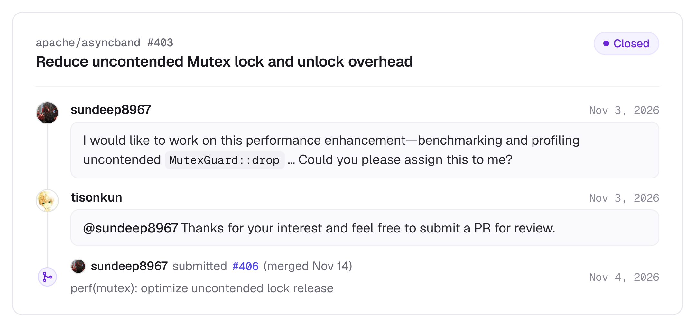
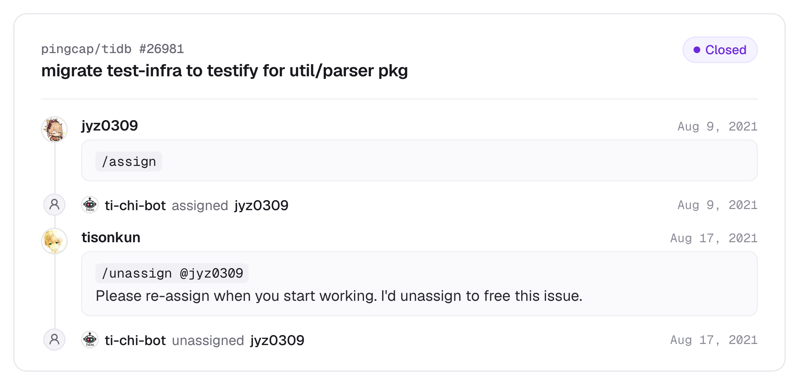
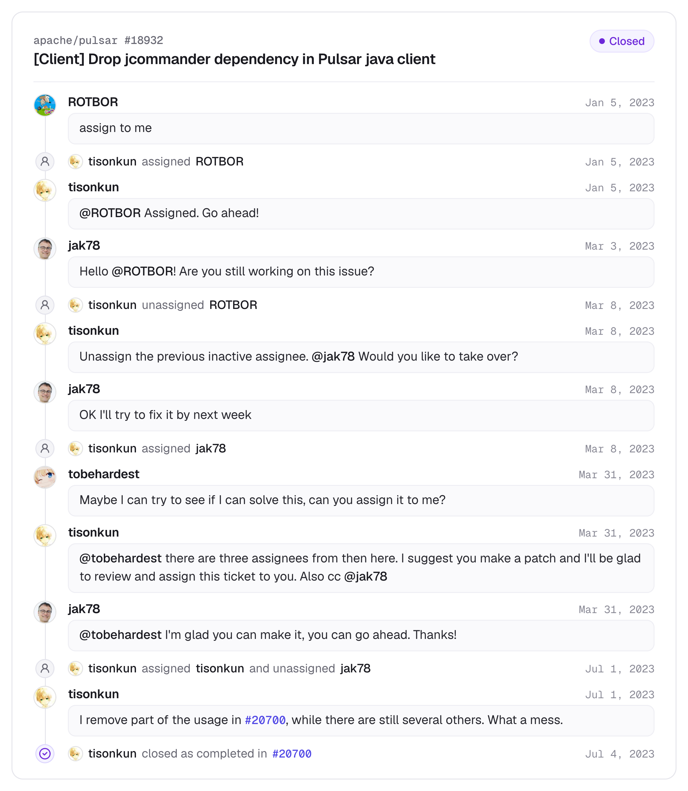
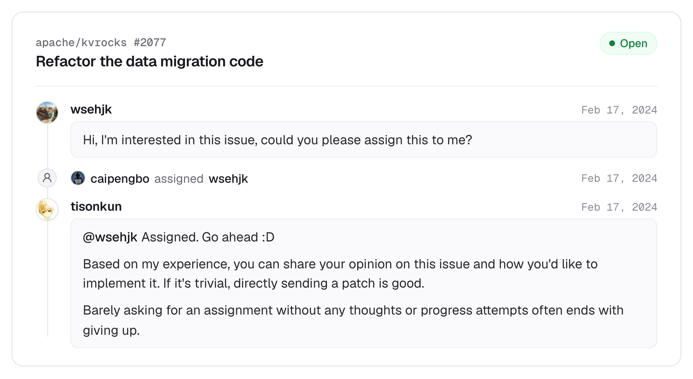
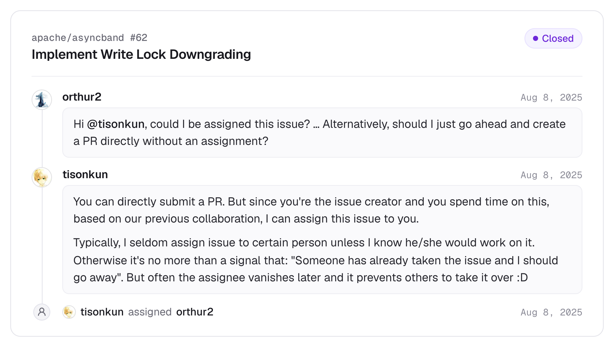

Whenever a contributor comments on one of my open-source projects asking to be assigned an issue, my reply is almost always the same: no assignment needed, just go ahead and submit a PR, and ping me when it is ready for review.

This is hardly a new problem. More than a decade ago, the open-source community popularized the phrase [Don't Lick the Cookie](https://www.redhat.com/en/blog/dont-lick-cookie): when only one cookie is left on the plate, a kid who does not want to eat it right now licks it and puts it back so nobody else will touch it. Most of the time, the cookie just sits there until it goes stale.

Assigning an open-source issue on a verbal request tends to have the exact same effect.

## Why I Stopped Assigning Issues

I did not start out opposed to issue assignment. During focused migration drives, such as TiDB's 2021 `testify` migration or Apache Kvrocks's 2022 TCL-to-Go test migration, the work was split into dozens of small, uniform subtasks and I had the bandwidth to track progress and unblock newcomers. Assigning issues worked reasonably well under those conditions.

In day-to-day open-source maintenance, however, assigning issues created far more friction than it solved.

Even during those migration drives, assignees regularly went silent after a week or two, leaving maintainers to patrol stale issues and manually release the seat.

In Apache Pulsar, I followed a straightforward dependency cleanup issue opened by [@syhily](https://github.com/syhily). Three contributors asked to be assigned one after another over six months. Each either left an unmergeable draft or never started at all, and I eventually wrote [PR #20700](https://github.com/apache/pulsar/pull/20700) to close it myself.

After enough rounds like that, I stopped trusting bare assignment requests. When someone asked to be assigned in Apache Kvrocks in early 2024, I assigned the issue anyway with a note warning that asking for assignment without any initial thoughts or progress often ends in giving up.

Sure enough, more than two years later, that issue is still open with zero PRs.

By contrast, opening a PR first and discussing assignment or review afterward saves everyone time.

By the time I was maintaining Apache Asyncband (Incubating), I started spelling this out directly: unless I already know someone is actively working on a task, assigning an issue does nothing to help them finish. Its only real effect is hanging a "taken, keep away" sign that discourages everyone else from stepping in.

(For what it is worth, the contributor in that thread kept showing up with solid patches, became an Asyncband PPMC member, and has since led releases for the project.)

Stepping back, issue assignment is largely a corporate task-tracking habit projected onto open source. Company-backed projects like TiDB built `/assign` directly into their bots, borrowing the workflow from Kubernetes. In volunteer-driven ASF communities, I already avoid proactively assigning issues to others because nobody here is an employee being handed a ticket. Over time, I pushed that principle one step further: even when someone proactively asks to be assigned, I almost never do it.

## What Happened After I Stopped Assigning

Over the past two years, across the repositories I actively maintain, I switched to a simple rule: no assignment, just go ahead and open a PR for review. That single change turned into a surprisingly clean filter for follow-through.

On one side, people who genuinely want to build something are never slowed down by the lack of an assignee badge:

- In Apache Asyncband ([ISSUE-215](https://github.com/apache/asyncband/issues/215) and [ISSUE-222](https://github.com/apache/asyncband/issues/222)), [@QwQBiG](https://github.com/QwQBiG) shipped two substantial primitives back to back without ever being assigned, and later became an Asyncband PPMC member.
- In Apache DataSketches Rust ([ISSUE-363](https://github.com/apache/datasketches-rust/issues/363)), a contributor did not even wait for a reply before outlining a plan and submitting [PR #371](https://github.com/apache/datasketches-rust/pull/371). The same held in Apache OpenDAL ([ISSUE-6647](https://github.com/apache/opendal/issues/6647)) and Fastrace ([ISSUE-186](https://github.com/fast/fastrace/issues/186)), where a quick "go ahead" was all it took to get working PRs merged.

On the other side, people who are not going to open a PR will not open one regardless of how fast you reply, and keeping the issue unlocked prevents them from blocking everyone else:

- In Asyncband ([ISSUE-292](https://github.com/apache/asyncband/issues/292)), OpenDAL ([ISSUE-6619](https://github.com/apache/opendal/issues/6619)), and Logforth ([ISSUE-145](https://github.com/fast/logforth/issues/145)), I replied the same day telling each requester they could start without assignment. None of them came back with a PR, and I eventually closed all three myself.
- In Asyncband ([ISSUE-388](https://github.com/apache/asyncband/issues/388)), a contributor asked "can i work on this" and went silent for five days. I drafted [PR #409](https://github.com/apache/asyncband/pull/409) and noted that we do not use an assign-and-lock workflow. To their credit, they took it to heart: a few days later, on [ISSUE-398](https://github.com/apache/asyncband/issues/398) (where someone else had just asked to be assigned), they skipped the question completely and opened [PR #412](https://github.com/apache/asyncband/pull/412), which was merged.

## Take One Step Forward

At bottom, commenting "Could you assign this to me?" is simply too low-effort to justify placing an exclusive lock on a public issue. Other contributors see a name attached and politely move on, while the assignee gets busy or hits unexpected complexity and feels awkward coming back to drop it.

AI coding tools have lowered that bar even further. Anyone can now point a model at a repository, produce a plausible-sounding analysis in ten minutes, and leave assignment requests across five or six issues without ever compiling the code or running a benchmark.

If you want to work on an issue, you do not need to lock it down first. Even if you only want to leave a comment, take one concrete step forward: run the reproduction locally and post the output, share real benchmark or profiling numbers, or open an early draft PR. Even an incomplete diff gives maintainers something concrete to review and discuss, which moves the project forward far more than asking for permission to start.
