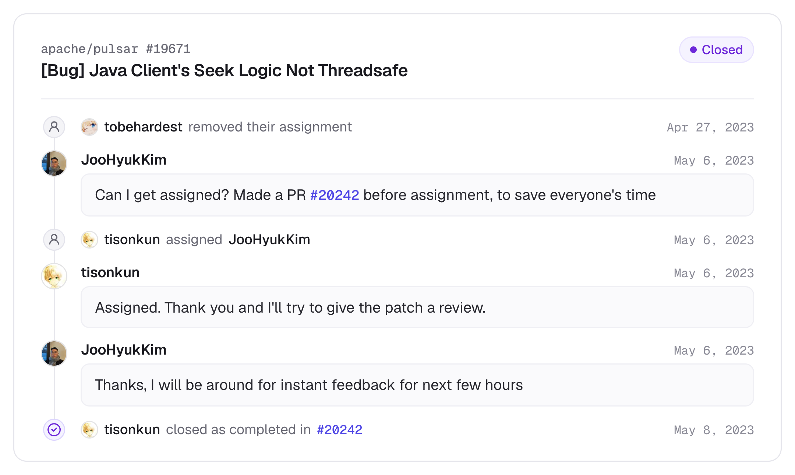

Whenever a contributor comments on one of my open-source projects asking to be assigned an issue, my reply is almost always the same: "Go ahead! Just submit a PR and ping me for review."

This isn't a new problem. Over a decade ago, the open-source community popularized the phrase [Don't Lick the Cookie](https://www.redhat.com/en/blog/dont-lick-cookie): a cheeky child wants the last cookie on the plate later, so she licks it and puts it back, "secure in the knowledge that no-one else will want to eat it."

Assigning an open-source issue on a verbal request tends to have the same effect.

## Why I Stopped Assigning Issues

I didn't start out against issue assignment. During focused migrations, like TiDB's 2021 `testify` migration or Apache Kvrocks's 2022 TCL-to-Go test migration, the work was broken down into many small, similar subtasks, and I had the time to follow up and help newcomers. Assigning issues worked fine in that setup.

In day-to-day open-source maintenance, though, assigning issues caused more trouble than it solved.

Even during those migrations, assignees regularly went silent after a week or two, leaving maintainers to check on stale issues and unassign them by hand.

In Apache Pulsar, I followed a straightforward dependency cleanup issue. Over six months, three contributors asked to be assigned one after another. Each either submitted a patch that couldn't be merged or never started at all, and I eventually wrote [PR #20700](https://github.com/apache/pulsar/pull/20700) to finish it myself.

After a few rounds like that, I stopped trusting bare assignment requests. When someone asked to be assigned in Apache Kvrocks in early 2024, I still assigned the issue, but left a note warning that asking for assignment without any thoughts or progress often ends in giving up.

Sure enough, more than two years later, that issue is still open with no PR.

By contrast, opening a PR first and talking about assignment or review afterward saves everyone time.

By the time I was maintaining Apache Asyncband (Incubating), I started saying this plainly: unless I already know someone is actively working on an issue, assigning it doesn't help them finish. Its only real effect is putting up a "taken, keep away" sign that stops others from stepping in.

By the way, [@orthur2](https://github.com/orthur2) kept contributing, became an Asyncband PPMC member, and has managed a release for the project.

From another angle, issue assignment comes from how companies hand out tasks to employees. Company-backed projects like TiDB built `/assign` directly into their bots, borrowed from Kubernetes. In volunteer-driven ASF communities, I already avoid assigning issues to other people because nobody here is an employee being handed a ticket. Over time, I took that one step further: even when someone asks to be assigned, I almost never do it.

## What Happened After I Stopped Assigning

Over the past two years, across the repositories I actively maintain, I switched to a simple rule: no assignment, just go ahead and open a PR for review. That made it very easy to tell two groups apart.

People who actually plan to write code aren't slowed down by not being assigned:

- In Apache Asyncband ([ISSUE-215](https://github.com/apache/asyncband/issues/215) and [ISSUE-222](https://github.com/apache/asyncband/issues/222)), [@QwQBiG](https://github.com/QwQBiG) shipped two major features back to back without ever being assigned, and later became an Asyncband PPMC member.
- In Apache DataSketches Rust ([ISSUE-363](https://github.com/apache/datasketches-rust/issues/363)), a contributor didn't even wait for a reply before sharing a plan and opening [PR #371](https://github.com/apache/datasketches-rust/pull/371). The same happened in Apache OpenDAL ([ISSUE-6647](https://github.com/apache/opendal/issues/6647)) and Fastrace ([ISSUE-186](https://github.com/fast/fastrace/issues/186)), where a quick "go ahead" was all it took to get working PRs merged.

Meanwhile, people who aren't going to open a PR won't open one no matter how fast you reply, and leaving the issue unassigned keeps it open for everyone else:

- In Asyncband ([ISSUE-292](https://github.com/apache/asyncband/issues/292)), OpenDAL ([ISSUE-6619](https://github.com/apache/opendal/issues/6619)), and Logforth ([ISSUE-145](https://github.com/fast/logforth/issues/145)), I replied the same day saying they could start without assignment. None of them came back with a PR, and I eventually resolved all three myself.
- In Asyncband ([ISSUE-388](https://github.com/apache/asyncband/issues/388)), someone asked "can i work on this" and went quiet for five days. I opened [PR #409](https://github.com/apache/asyncband/pull/409) and noted that we don't use an assign-and-lock workflow. They actually took the hint: a few days later, on [ISSUE-398](https://github.com/apache/asyncband/issues/398) (where someone else had just asked to be assigned), they skipped the question and opened [PR #412](https://github.com/apache/asyncband/pull/412), which was merged.

## Take One Step Forward

Commenting "Could you assign this to me?" is simply too low-effort to justify putting an exclusive lock on a public issue. Other contributors see a name attached and move on, while the assignee gets busy or runs into unexpected trouble and feels awkward coming back to drop it.

AI coding tools have made this even cheaper. Anyone can now point a model at a repo, write a reasonable-looking analysis in ten minutes, and leave assignment requests across five or six issues without ever compiling the code or running a benchmark.

If you want to work on an issue, you don't need to claim it first. Even if you only want to leave a comment, take one concrete step forward: run the reproduction locally and post the output, share real benchmark numbers, or open a draft PR. Even an incomplete diff gives maintainers something concrete to review and discuss, which helps the project far more than asking for permission to start.
